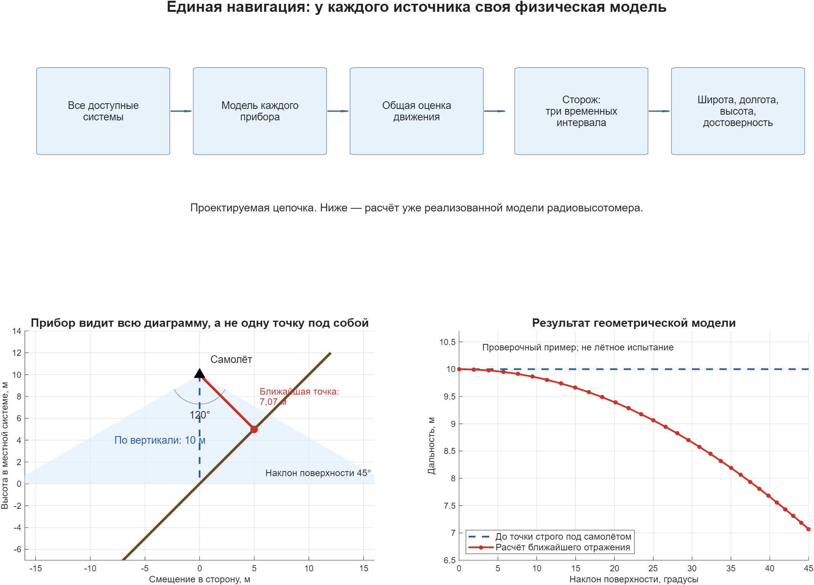
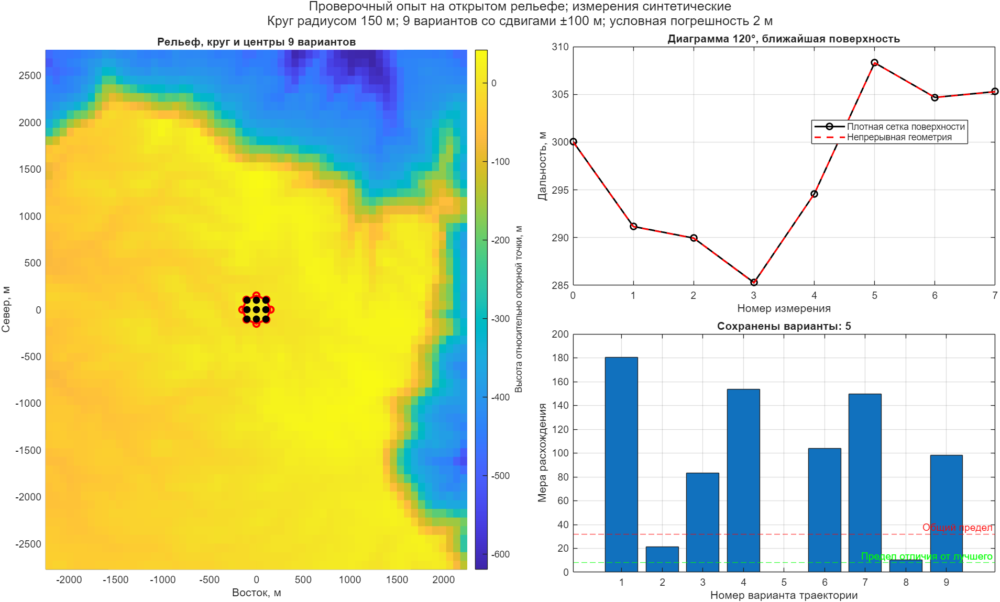

# Единая навигация: назначение, системы и алгоритм

## Задача и состав систем

Нужно получить одно согласованное положение, скорость и ориентацию самолёта по всем доступным источникам. Отдельный сторож проверяет, можно ли применять результат. На выходе — **широта, долгота, высота, оценка погрешности и признак достоверности каждой величины**. Для высоты обязательно указывается поверхность отсчёта.

| Система или источник | Что получаем | Для чего используем |
|---|---|---|
| Инерциальная система: гироскопы и акселерометры | Угловые скорости и ускорения; после обработки — ориентацию, скорость и счисленное положение | Непрерывно продолжаем оценку движения между внешними измерениями |
| Спутниковая навигация: ГЛОНАСС, GPS и другие доступные созвездия | Положение и скорость либо исходные дальности до спутников и скорость их изменения | Уточняем положение, скорость и накопленные ошибки инерциальной системы |
| Дальномерные радиосредства DME | Наклонные дальности до известных наземных станций | Получаем геометрические ограничения на положение, в том числе по нескольким станциям |
| Угломерные радиосредства VOR | Направление от наземной станции на самолёт | Дополняем дальномерные измерения и проверяем согласованность положения |
| Радиомаячная система посадки ILS, если установлена | Отклонения от курса и глиссады | Уточняем положение относительно линии захода в пределах применимости системы |
| Спутниковая система посадки с наземными поправками GLS, если установлена | Навигационные данные и отклонения относительно заданного захода | Используем по её модели и учитываем общую зависимость от спутниковых измерений |
| Спутниковые поправки и средство захода SLS, если предусмотрены | Уточнённые спутниковые координаты и отклонения от линии захода | Учитываем источник поправок, пригодность и общую зависимость от спутниковых данных |
| Готовые решения воздушно-инерциальной системы, системы управления полётом и вычисляемого захода FLS | Положение, скорость, ориентацию, отклонения и признаки качества | Используем сведения о происхождении; уже объединённые данные повторно как независимые не учитываем |
| Система воздушных данных | Давление, температуру, воздушную скорость; углы атаки и скольжения — при наличии соответствующих приборов | Связываем движение относительно воздуха с движением относительно земли; учитываем ветер |
| Барометрический канал системы воздушных данных | Высоту, полученную из давления | Проверяем и уточняем вертикальное движение с учётом атмосферы и ошибки установки давления |
| Радиовысотомер | Дальность до ближайшей отражающей поверхности в заданной диаграмме | Сопоставляем измерения с рельефом; не считаем их автоматически расстоянием до точки строго под самолётом |
| Матрица высот | Координаты и высоты поверхности, шаг сетки, пропуски и погрешности | Рассчитываем ожидаемое показание радиовысотомера для каждого возможного положения |

Барометрический канал входит в систему воздушных данных. Он не становится вторым независимым источником от повторного перечисления. Аналогично готовое навигационное решение, уже исправленное по спутникам, нельзя считать независимым подтверждением тех же спутниковых измерений.

Карта — справочные данные, а не новый измерительный прибор. Её ошибки могут повторяться во многих измерениях.

## Полнота методов навигации

**Состав libekf не ограничивается текущим набором программных моделей. В общую оценку должны включаться все предусмотренные на аппарате способы навигации.** Наличие метода в этой постановке означает требование к подключению, а не утверждение, что соответствующий прибор установлен или его обработка уже написана.

| Метод | Что связывает с общей оценкой | Что необходимо учитывать |
|---|---|---|
| Инерциальное счисление | Изменение скорости, положения и ориентации | Смещения и шум гироскопов и акселерометров, вращение Земли, тяжесть |
| Воздушное счисление | Воздушную скорость и направление движения относительно воздуха | Ветер, плотность воздуха, ошибки давления и температуры; воздушная скорость не равна путевой |
| Спутниковая навигация | Координаты, скорость, время либо исходные измерения спутников | Созвездия, часы, поправки, помехи, ложный сигнал и общие ошибки |
| Наземная радионавигация | Дальности, направления, разности дальностей или времени прихода сигналов | Координаты станций, синхронизацию, распространение сигнала, рабочую область; предусмотрены DME, VOR, NDB/АРК, TACAN, РСБН, РСДН и другие установленные средства со своими моделями |
| Доплеровская навигация | Скорость относительно наблюдаемой поверхности по сдвигу частоты отражённого сигнала | Направления измерения, ориентацию, свойства поверхности и качество отражения |
| Навигация по высоте | Ограничение вертикального положения | Барометрическую, спутниковую и радиовысоту связывают разные модели и разные поверхности отсчёта |
| Привязка к рельефу | Положение по последовательности высот и карте | Широкую диаграмму радиовысотомера, ориентацию, карту, ошибку высоты и неоднозначные участки |
| Оптическая и радиолокационная привязка к карте | Положение по распознанным ориентирам и изображениям местности | Геометрию наблюдения, освещённость или условия отражения, ошибки распознавания и карты |
| Визуальная одометрия в видимом диапазоне по последовательности кадров | Перемещение и поворот камеры между моментами съёмки | Масштаб, калибровку камеры, время кадров, общие наблюдения; относительное движение само по себе не определяет абсолютное положение |
| РСДН — радиотехническая система дальней навигации | Разности времени прихода сигналов станций | Геометрию цепи, задержки излучения и распространения, общую опорную станцию, неоднозначность сигналов |
| Магнитные измерения | Направление магнитного поля и при соответствующей постановке сопоставление с картой поля | Магнитное склонение, влияние аппарата, помехи и погрешность модели; один магнитный курс не определяет координаты |
| Астрономические наблюдения | Направления на небесные ориентиры | Точное время, видимость и геометрию; определение ориентации по звёздам само по себе не означает определения земных координат |
| Внешняя и взаимная навигация | Дальности, направления и относительное положение от наземных или других бортовых средств | Положение опорного объекта, задержку, синхронизацию и общие исходные данные |
| Средства захода и посадки | Положение и отклонения относительно заданного захода | Физическую основу конкретного средства; ILS, GLS, SLS и вычисляемый FLS не объявляются независимыми по одному различию названий |

Это перечень семейств методов для проектирования. Конкретное средство включается через собственную модель измерения и описание применимости. Если прибор выдаёт дальность, направление или изображение, нельзя без обоснования подменять его готовой точкой положения с произвольной погрешностью. Для каждого нового метода определяются измеряемая величина, единицы, момент измерения, оси, ошибки, зависимости, признаки отказа и условия использования сторожем.

Наземные радиосредства, инерциальная и доплеровская навигация представлены в [FAA AIM, глава «Воздушная навигация»](https://www.faa.gov/air_traffic/publications/aim_html/chap_1.html). Пример принципа сопоставления изображений с картой — [NASA, навигация относительно рельефа](https://techport.nasa.gov/projects/94147). Различие определения ориентации по звёздам и оптической оценки дальности/направления показано в [описании средств Orion](https://www.nasa.gov/reference/avionics-and-software/). Космические примеры поясняют физические принципы; их применимость к самолёту требует отдельного обоснования.

**Граница имеющейся реализации:** в общий оцениватель входят подготовленные физические измерения: дальности и пеленги, разности времени РСДН, доплеровские проекции скорости, давления, магнитный вектор, координаты распознанных ориентиров и относительное движение камеры. Их модели не заменяют приём и обработку исходных радиосигналов, распознавание кадров, приборную калибровку или подготовку атмосферных и каталожных данных. Эти входные обработчики ещё не завершены. Для кадров выполнен исследовательский опыт, но пригодное для автоматической поправки наблюдение с полной погрешностью пока не сформировано. Все предусмотренные семейства остаются в составе задачи; наличие общей модели готового положения или скорости не считается реализацией остальных способов навигации.

## Что берём из устройства навигации Airbus

Практический ориентир — сохранение навигационной функции за счёт разных источников и контроля их пригодности. Оснащение и распределение вычислений зависят от семейства самолёта и его комплектации.

В описании Airbus при потере спутникового сигнала для семейств A300/A310, A320, A330/A340, A350 и A380 приведена последовательность: совместное спутниково-инерциальное положение → инерциальная система с дальностями от двух DME → инерциальная система с VOR/DME → инерциальное продолжение. Доступные операции при ухудшении точности могут ограничиваться. На A350 вычисления этой части отнесены к воздушно-инерциальной системе, на других перечисленных семействах — к системе управления полётом в описанной конфигурации. Это подтверждает смысл резервирования источников, но не обещает безошибочность любого оставшегося набора. [Airbus: помехи спутниковой навигации](https://safetyfirst.airbus.com/gnss-interference/).

Потеря спутникового сигнала и приём ложного сигнала — разные события. В той же публикации Airbus описывает случаи, когда ложное положение могло быть принято системой; для A350 отмечено дополнительное объединение источников и наблюдение за положением. Поэтому сторож должен обнаруживать не только отсутствие пакетов, но и правдоподобное ошибочное решение. Это важная граница исходного предположения «самолёт всегда знает о потере навигации». Для нашего сценария восстановления момент потери считается обнаруженным. [Тот же источник Airbus](https://safetyfirst.airbus.com/gnss-interference/).

Для захода Airbus объединяет средства ILS, GLS, SLS и FLS общим способом представления отклонений. ILS использует наземные радиомаяки; GLS — спутниковые данные с поправками наземной станции; SLS — спутниковые данные с поправками спутниковой системы; FLS вычисляет отклонения по навигационному решению и заданной траектории. Эти функции не являются четырьмя независимыми измерителями положения: для GLS/SLS/FLS необходимо учитывать исходные данные, уже участвовавшие в общей оценке. [Airbus: применение средств захода](https://safetyfirst.airbus.com/lets-use-xls/).

Airbus отдельно показывает, что ошибочная установка барометрического давления может одновременно исказить высоту и проверку по высоте/дальности, использующую ту же высоту. Согласие таких величин не доказывает правильность. Для libekf это основание учитывать общую причину ошибок и независимость проверки. [Airbus: установка барометрического давления](https://safetyfirst.airbus.com/use-the-correct-baro-setting-for-approach/).

Из открытых материалов не устанавливаются исходный код, конкретная матрица состояния или коэффициенты фильтра Airbus. **Наша проектная идея** — собрать все предусмотренные навигационные наблюдения, инерциальное продолжение и проверку достоверности в согласованную систему; дополнить её восстановлением по рельефу. Привязка по радиовысотомеру и карте в этом документе — задача libekf, а не подтверждённая штатная функция перечисленных Airbus.
## Последовательность работы

1. **Сохраняем непрерывность.** Инерциальная система продолжает положение, скорость и ориентацию от последнего принятого состояния. Погрешность при отсутствии внешних поправок увеличивается.
2. **Проверяем входы.** Для каждого измерения известны прибор, время, единицы, местные оси, погрешность и признак исправности. Отсутствующее значение не заменяется нулём. Запоздалое измерение нельзя сравнивать с состоянием другого момента времени.
3. **Предсказываем, что должен показать прибор.** Каждая система имеет свою физическую модель. Например, дальномер измеряет расстояние до станции, а воздушная скорость зависит также от ветра. Модель выражает ожидаемое показание в тех же осях и единицах, что и реальное измерение.
4. **Сравниваем измерение с ожиданием.** Фильтр Калмана использует пригодные расхождения для уточнения общего состояния и его погрешности. Вес измерения определяется моделью ошибок, а не только числом согласных приборов.
5. **Проверяем результат сторожем.** При отказах исключаем недопустимые данные и пересматриваем пригодность отдельных выходов. Неисправный источник не должен испортить последнее принятое состояние.

Фильтр оценивает движение. Сторож решает, можно ли доверять этой оценке для заданной задачи. Эти обязанности различаются.

## Радиовысотомер и рельеф

В рассматриваемой задаче приняты диаграмма **120°** и ограничение достоверности **2000 м**. Это исходные условия пользователя; паспорт прибора ещё не проверен. Тип ограничиваемой высоты должен быть указан в его описании. В проверочном примере ограничивается измеряемая дальность.

Для каждого возможного положения рассматриваем **всю поверхность внутри диаграммы**, учитывая ориентацию самолёта. Ожидаемое показание — расстояние до ближайшей точки этой поверхности. Склон, бровка оврага или возвышенность сбоку могут оказаться ближе точки под самолётом.

На рисунке — **расчётный пример**, а не лётное испытание. Самолёт находится на высоте 10 м над началом наклонной поверхности. При наклоне поверхности 45° ближайшая точка расположена в стороне: дальность равна примерно 7,07 м, хотя до точки строго под самолётом — 10 м. Справа показано, как меняется ожидаемая дальность при изменении наклона. Все точки рассчитаны одной моделью широкой диаграммы.

Поверхность описывается сеткой треугольников с реальными координатами вершин. Это не одна плоскость для всего района. Поиск ближайшей точки выполняется внутри треугольников и на их границах, а не только по узлам карты или нескольким выбранным направлениям.

Если карта неполна, источник сообщил недостоверность или показание вышло за подтверждённые условия применения, поправка запрещается. При нескольких одинаково близких поверхностях либо смене отражающего участка нельзя без проверки применять единственную гладкую поправку. Погрешность карты, растительность, размер области отражения и особенности выбора отражённого сигнала требуют отдельного учёта. Сам расчёт расстояния их не доказывает.

## Если положение потеряно

Считаем, что момент потери обнаружен. По последнему достоверному состоянию и инерциальному продолжению строим область возможных положений. Для нескольких возможных траекторий рассчитываем последовательности ожидаемых показаний радиовысотомера и сравниваем с измеренной последовательностью.

Если самолёт выполняет круг, в последовательность попадают разные участки поверхности. Это помогает различить варианты, но не гарантирует привязку: на однообразном рельефе несколько траекторий могут давать сходные показания.

Сохраняем несколько правдоподобных вариантов, пока наблюдений недостаточно. **Разные местоположения нельзя просто усреднить и назвать найденной координатой.** Подтверждённую привязку передаём в общую навигацию с её временем и оценкой погрешности. Одни и те же показания не используются повторно как независимые данные сначала в привязке, а затем ещё раз в общей оценке.

Карта должна покрывать всю область возможного положения, возможные траектории и поверхность, попадающую в диаграмму прибора. Площадь определяется этой геометрией и исходной неопределённостью. Универсального размера поля карты нет.

## Три временных интервала и системы координат

| Интервал | Что проверяет сторож |
|---|---|
| Короткий | Скачок, потерю измерений, недопустимые значения, вычислительный отказ |
| Средний | Устойчивость привязки и согласованность последовательности измерений |
| Длинный | Медленный дрейф, повторяющееся смещение, длительные расхождения между источниками |

Длительности подбираются по динамике самолёта и допустимому времени обнаружения отказа. Быстрый отказ не ждёт заполнения длинного интервала. Согласие трёх проверок одной истории не считается тремя независимыми измерениями.

На разных интервалах разрешены удобные местные системы координат. При переходе вместе преобразуются состояние, его погрешности и диагностическая история. Отдельно учитываются местные оси датчика, общая навигационная система и географические координаты выхода. Кривизна Земли при этом сохраняется.

Большие земные координаты сами по себе не переполняют `double`. Но вычитание близких больших чисел ухудшает вычисление малых изменений. Поэтому измерения обрабатываются относительно местной опоры; величины с разными единицами приводятся к сопоставимым масштабам. Для оценки расхождения решается система линейных уравнений — явное обращение матрицы не требуется.

### Статус проверки географического выхода

В `nav_geodetic_output` результаты сторожа назначаются отдельно широте, долготе и высоте. Для каждой величины передаётся список обязательных проверок, повторно оценённых на момент публикации. Проверки относятся к указанным времени состояния и системе координат. Вызывающая сторона отвечает за соответствие проверок именно публикуемому решению и за полноту их состава; одно совпадение времени не доказывает независимость проверки.

| Состояние проверок величины | Выходной статус |
|---|---|
| Есть тревога хотя бы одной назначенной проверки | `ALARM` |
| Все назначенные проверки готовы на трёх интервалах и согласованы | `CONSISTENT` |
| Список пуст, проверка отсутствует или ещё не готова | `NOT_READY` |
| Контроль вообще не передан | `UNASSESSED` |

Результат сторожа от прежнего момента публикации не принимается: историю нужно переоценить на текущее время, чтобы обнаружить устаревание данных. Проверка высоты не подтверждает широту и долготу. Особенности координат сохраняют приоритет: например, долгота на полюсе остаётся неопределённой. Координаты и ковариация доступны вместе со статусом; решение об их использовании принимает потребитель по требованиям своей функции. `CONSISTENT` не означает подтверждённую эксплуатационную пригодность: ещё нужны независимость каналов, критерии наблюдаемости, изоляция отказов и обоснованные пределы погрешности.

## Что считается подтверждённым

Два исправных источника позволяют сохранить пригодное решение, если вместе определяют нужные величины и позволяют выполнить проверку. Например, два высотомера не дают полного горизонтального положения. Для каждого допустимого сочетания нужны свои условия и критерии.

### Что определяют оставшиеся источники

`nav_observability` проверяет локальную определимость выбранных величин по совместной линейной модели измерений. Она не использует априорную ковариацию фильтра: малое значение в ней не должно скрывать отсутствие информации в рассматриваемых источниках. Передаются матрица чувствительности $H$, полная ковариация измерений $R$, диагональная матрица положительных физических масштабов ошибок $D$ и матрица выбранных выходов $C$.

При разложении $R=LL^T$ анализируется матрица $A=L^{-1}HD$. Обратная матрица в коде не строится: решаются линейные системы. Сингулярное разложение $A$ выделяет направления ошибок, которые измерения различают. Выбранная величина определима, только если её строка $CD$ не содержит составляющей в остальных направлениях.

Для определимых величин возвращается дисперсия линейной оценки по этим измерениям; для неопределимых — бесконечность. Нулевой информационный вклад нельзя заменять нулевой дисперсией. Численный порог ранга задаётся явно и зависит от согласованных масштабов. Даже формально определимая величина может иметь неприемлемо большую дисперсию: проверка допустимой точности выполняется отдельно.

Проверены общая ошибка двух барометрических высот, разделение высоты и смещения при добавлении геометрической высоты, неразличимость ветра и путевой скорости по одной воздушной скорости, сохранение результата при смене единиц и случай слабой чувствительности. Для последовательности измерений сначала нужны матрицы перехода ошибок к одному моменту и полная модель зависимостей ошибок; простое объединение строк разных времён некорректно. Проверка локальная: она не исключает несколько удалённых вариантов положения на рельефе, не обнаруживает неисправность сама по себе. При передаче геометрии измерений в географический выход результат участвует в назначении статусов.

При публикации `control.geometry` содержит $H$, $R$, масштабы ошибок, численный порог и три допустимые дисперсии выходов: для широты и долготы в градусах², для высоты в м². Производные этих выходов по состоянию рассчитываются из текущего положения, а не передаются готовыми признаками. Ненаблюдаемая величина получает `UNOBSERVABLE`; наблюдаемая, но с дисперсией выше заданного предела — `INSUFFICIENT_ACCURACY`. Тревога сторожа и неопределённость координат на полюсе имеют приоритет. Прохождение геометрической проверки не отменяет неготовность сторожа.

Отдельно публикуются признаки наблюдаемости и достаточности точности, а также дисперсии по переданным измерениям. Они не заменяют ковариацию текущей оценки фильтра. Без `control.geometry` выход содержит только результаты назначенных проверок сторожа; вывод о наблюдаемости тогда не делается. Подготовка согласованной геометрии измерений за историю и эксплуатационных пределов остаётся обязанностью вызывающей системы. Статус `VALID` эта проверка не назначает.

Текущее состояние реализации:

| Направление | Что реализовано | Что ещё требуется |
|---|---|---|
| Общее оценивание | Инерциальное продолжение, поправка одного состояния или связанной пары, заданные зависимости ошибок, географический выход | Полная обработка временной последовательности, освобождение истории без повторного учёта, итоговая пригодность |
| Радио-, спутниковые и воздушные наблюдения | Модели подготовленных координат, скоростей, дальностей, углов, разностей времени, доплеровской скорости, баровысоты и воздушных данных | Преобразования конкретных приборов, исходных сигналов, давления и температуры; фактические модели ошибок |
| Рельеф | Ближайшая поверхность внутри широкой диаграммы, сопоставление заданных траекторий, опыт на открытой карте | Полный поиск по неопределённости и подтверждённая передача привязки в фильтр |
| Визуальная одометрия | Геометрические наблюдения движения, совместная поправка пары, явная смена опоры; отдельные опыты на фотографиях и диагностика неоднозначности | Надёжная обработка видеопотока, зависимость общих кадров, полная погрешность результата |
| Магнитные и небесные ориентиры | Наблюдения по подготовленному магнитному полю и направлениям | Подготовка поля, каталога и направлений; распознавание и приборные поправки |
| Сторож | Сопоставление двух решений с общими ошибками, проверка ряда расхождений на F/M/S | Независимые проверки реальных каналов, изоляция отказов и обоснование пригодности; передача статусов по отдельным координатам реализована |
| Испытания | Численные проверки требований в одном файле и отдельные исследовательские опыты | Полные сценарии отказов, реальные данные и подтверждение эксплуатационных требований |

Наличие модели наблюдения не означает готовности соответствующего бортового тракта. Общая задача ещё не завершена.

Математические первоисточники: [описание статей](filter_sources.md). Принципы испытаний: [методология](../Principes/testing_methodology.md).

## Входы, выходы и обязанности

| Участник | Что передаёт | Что получает или делает |
|---|---|---|
| Измерительная система | Значение, единицы, время измерения, местные оси и положение прибора, оценку погрешности, исправность | Сохраняет собственный смысл измерения; не объявляет готовым общее положение самолёта |
| Модель измерительной системы | Ожидаемое показание и связь с общим состоянием | Учитывает геометрию, размещение прибора, задержку и свойства ошибок |
| Общее оценивание | Предыдущее состояние и пригодные наблюдения | Продолжает движение и уточняет состояние; сохраняет оценку погрешности |
| Восстановление по рельефу | Область поиска, движение, радиовысотомер, барометрический канал и карту | Сравнивает возможные траектории; выдаёт найденную привязку либо сохраняет несколько вариантов |
| Сторож | Диагностику источников, расхождения и результаты независимых проверок | Выдаёт пригодность по величинам, причины ограничений и момент последнего пригодного решения |
| Потребитель навигации | Требования к точности, свежести и доступным функциям | Получает широту, долготу, высоту, скорость, ориентацию, погрешность и статус; действует по доступным возможностям |

Решение относится к своему времени. Время получения пакета, время измерения и время выдачи результата различаются. Высота указывается над эллипсоидом, принятой уровенной поверхностью либо рельефом; одно значение не переименовывается в другое без преобразования.

## Требования, сохраняемые при разработке

Обозначения нужны для связи теории с проверками. Они сохраняют смысл прежнего документа после переименования.

| Обозначение | Требуемое поведение |
|---|---|
| LEKF-001 | Одна согласованная оценка состояния по всем предусмотренным навигационным системам; явные время и координаты |
| LEKF-002 | Вычисление оценки и признание её пригодной разделены |
| LEKF-003 | Каждый источник имеет физически обоснованный путь в общее решение или его проверку |
| LEKF-004 | Зависимые и повторные данные не учитываются как независимые |
| LEKF-005 | Воздушная и путевая скорости, разные виды высоты сохраняют свой смысл |
| LEKF-006 | Состояние движения и малые поправки к нему определены однозначно, включая соглашение об ориентации |
| LEKF-007 | После поправки согласованно изменяется оценка погрешности; её нельзя обнулить вместе с поправкой |
| LEKF-008 | Известны источник, происхождение, время, единицы, качество и модель ошибки каждого отсчёта |
| LEKF-009 | Принятые состояние, результат и качество публикуются согласованно; отклонённая поправка не повреждает состояние |
| LEKF-010 | Сторож выполняет самостоятельную проверку; свежесть и исправность его решения тоже учитываются |
| LEKF-011 | Критерии расхождений имеют численное основание, время обнаружения и оценку ложных тревог/пропусков |
| LEKF-012 | Проверка учитывает общие причины ошибок; само согласие фильтра с собой не доказывает достоверность |
| LEKF-013 | Выдаются пригодность каждой величины, причины ограничений, использованные источники и возраст результата |
| LEKF-014 | Отказ, автономное продолжение и восстановление имеют явные условия; старое решение не выдаётся за новое |
| LEKF-015 | Работа по оставшимся исправным системам обеспечивает только те величины, для которых достаточно информации |
| LEKF-016 | Проверяются допустимые сочетания источников и возможность выделить исправные каналы среди неисправных |
| LEKF-017 | Сторож использует короткую, среднюю и длинную историю |
| LEKF-018 | Быстрое нарушение не ждёт длинной истории; неготовность длинной проверки указывается явно |
| LEKF-019 | Длительности и покрытие трёх интервалов выбираются по динамике и требованиям к обнаружению |
| LEKF-020 | История ограничена по памяти, учитывает разрывы и смену источников; старые наблюдения не становятся новыми |
| LEKF-021 | Местные оси датчиков, системы разных временных масштабов и географический выход связаны согласованными преобразованиями |
| LEKF-022 | Малые поправки и меры расхождения вычисляются с местной опорой и согласованными масштабами |
| LEKF-023 | Радиовысотомер рассматривает всю диаграмму и ближайшую поверхность; учитываются диапазон прибора и покрытие карты |
| LEKF-024 | Поиск по рельефу сохраняет правдоподобные варианты до достаточного основания выбора |
| LEKF-025 | Визуальная одометрия связывает состояния на моменты кадров с учётом ошибок обоих состояний и их взаимной зависимости |
| LEKF-026 | При неизвестном масштабе изображения ограничивают направление и поворот; метрическое перемещение не объявляется измеренным |
| LEKF-027 | Разности времени РСДН учитывают задержки станций и распространения, а также общую ошибку опорной станции |

## Краткое математическое основание

Состояние включает положение, скорость, ориентацию и необходимые ошибки приборов. При подключении воздушных данных учитывается ветер; при подключении барометрии — её смещение; при работе с исходными спутниковыми дальностями — ошибки часов. Окончательный состав определяется наблюдениями и требуемым результатом.

Основной шаг прост: сначала продолжить движение, затем сравнить ожидаемое показание каждого прибора с измеренным и внести обоснованную поправку.

$$
r_k=z_k-h_k(\hat x_k^{-}).
$$

Здесь $z_k$ — вектор измерений в момент $t_k$; $h_k$ — модель показаний прибора; $\hat x_k^{-}$ — оценка состояния до поправки; $r_k$ — невязка. Компоненты невязки сохраняют единицы соответствующих измерений.

Ковариации ошибок состояния и измерений определяют вес поправки. Взаимные ковариации описывают зависимость ошибок разных величин; их учитывают при повороте осей и объединении источников.

Расчётная дальность радиовысотомера в принятой модели ближайшего отражения:

$$
\hat\rho_k=\min_{q\in\mathcal S\cap\mathcal D_k}\|q-p_{a,k}\|_2.
$$

Область внутри диаграммы задаётся отдельно:

$$
\mathcal D_k=\left\{q\ne p_{a,k}:\frac{(q-p_{a,k})^T d_k}{\|q-p_{a,k}\|_2}\ge\cos\alpha\right\}.
$$

Обозначения:

- $p_{a,k}$ — положение антенны в момент $t_k$, м;
- $q$ — точка поверхности карты $\mathcal S$, м;
- $d_k$ — единичный вектор оси диаграммы;
- $\alpha=60^\circ$ — половина принятой ширины диаграммы $120^\circ$;
- $\mathcal D_k$ — область внутри диаграммы;
- $\hat\rho_k$ — расчётная дальность, м.

Все координаты и направления заданы в одной местной системе. Минимум выбирается по поверхности карты внутри диаграммы. При пустом пересечении или неполном покрытии карты расчётное показание не определено.

Потерянное положение восстанавливается по последовательности таких измерений. Если несколько траекторий объясняют её одинаково хорошо, одного локального уточнения фильтром недостаточно для выбора между ними.

### Запрет данных неисправного источника

Признак качества отдельного пакета и решение диагностики об исправности источника учитываются совместно. После принятого сообщения об отказе новые данные этого источника не входят в общую оценку, даже если сам прибор продолжает выдавать признак `VALID`. Другие источники сохраняют возможность уточнять состояние. Возврат источника разрешается отдельным сообщением о восстановлении.

Событие `source_health` содержит источник диагностического сообщения `source`, источник проверяемых данных `target_source`, логический признак исправности `valid`, время события `t_measure`, время получения `t_received`, качество сообщения и идентификаторы его происхождения. Запрет хранится в `excluded_sources` общего состояния обработчика и воспроизводится при пересчёте истории. Источник связывается по постоянному идентификатору прибора, а не по названию физической модели: переименование модели не снимает запрета. Для вычисленного наблюдения поле `input_sources` перечисляет постоянные идентификаторы всех приборов, от которых оно зависит, включая косвенные зависимости. Если хотя бы один из них запрещён, наблюдение отклоняется независимо от имени передавшего его вычислителя. Например, координата бортового вычислителя, полученная с использованием отказавшего спутникового приёмника, не становится допустимой из-за другого значения `source`. После восстановления приёмника зависимые данные снова проходят обычные проверки качества, времени, погрешности и согласованности.

Список зависимостей формирует входная обработка конкретной системы. Он должен быть полным; обработчик не восстанавливает скрытые связи по названию прибора. Отсутствие списка означает только отсутствие сообщённых дополнительных зависимостей, а не доказанную независимость. `input_sources` определяет допуск по исправности; идентификаторы отсчётов `lineage` предотвращают повторный учёт, а ковариации описывают статистическую зависимость. Эти сведения не заменяют друг друга. Список не имеет единиц измерения и не меняет физическую модель наблюдения.

Запрет влияет на последующие измерения. Для удаления уже внесённой ошибочной информации нужен пересчёт от состояния, предшествующего отказу, с событием запрета в соответствующий момент. Само сообщение об отказе не очищает накопленную оценку. Если влияние отказа уже вошло в исходное состояние сохранённой истории, одного пересчёта этой истории недостаточно.

Сообщение само по себе не изменяет координаты и ковариацию. При одинаковом времени события исполняются в порядке входного списка; запрет должен предшествовать измерению, которое требуется исключить. Если запрещён используемый инерциальный источник, продолжение по нему отклоняется. При отказе внутри инерциального интервала весь этот интервал возвращается без изменения входного состояния: выбор резервной ИНС или иной модели продолжения должен быть задан отдельно. Автоматическое переключение пока не реализовано.

Проверены запрет, восстановление и сохранение допуска другого источника для 30 обычных моделей наблюдений, а также запрет продолжения по ИНС после события отказа внутри интервала. Самостоятельная постановка диагноза и проверка общей причины отказов остаются незавершённой частью сторожа.

### Изменение исправности опоры во времени

Сообщение о неисправности опоры имеет собственные время события, время получения и идентификатор происхождения. При пересчёте истории оно применяется в момент события: последующие дальности к этой опоре отклоняются. Восстановление исправности задаётся отдельным сообщением со своим временем. Сообщение не исправляет координаты и не уменьшает ковариацию; оно изменяет только допуск измерений от выбранной опоры. Уже накопленные зависимости ошибок сохраняются.

В общем обработчике это событие `reference_health`: `peer_id` выбирает опору, логический `valid` задаёт её исправность, `quality` характеризует достоверность самого сообщения. Неизвестная опора, повторное, недостоверное, просроченное или ещё не полученное сообщение не изменяет решение. Допустимый возраст задаёт вызывающая сторона. Это обработка результата диагностики; самостоятельное обнаружение и изоляция неисправности остаются задачей сторожа.

### Общая ошибка опорной станции

Повторные дальности до одной станции содержат общую ошибку её координат. Её нельзя каждый раз объявлять независимым шумом. При совместной обработке зависимость входит во внедиагональные элементы ковариации дальностей. При последовательной обработке среднее, ковариация следующего измерения и его связь с ошибкой текущей оценки должны учитывать уже принятые данные.

Проверочный одномерный случай: начальная дисперсия положения — 4 м², общая дисперсия ошибки станции — 9 м², независимая дисперсия каждой дальности — 1 м². Матрица ковариации двух дальностей, в м²:

$$
R=\begin{bmatrix}10&9\\9&10\end{bmatrix}.
$$

При первой невязке 0 м и второй 1 м совместное решение даёт поправку $4/27$ м и дисперсию $76/27$ м². Последовательный расчёт даёт тот же результат:

| Величина после первого отсчёта | Значение, м² |
|---|---:|
| Дисперсия положения самолёта | $20/7$ |
| Условная дисперсия ошибки второго измерения | $59/14$ |
| Взаимная ковариация ошибки положения и второго измерения | $-18/7$ |

Для дальности до объекта с неопределённым положением (`cooperative_range`) совместная поправка реализована. После принятого измерения `peer_update` возвращает положение объекта, его ковариацию и взаимную ковариацию с навигационным состоянием, время и систему координат. Следующая дальность должна использовать эти уточнённые величины. При отклонении или повторной подаче исходного отсчёта обновление не выдаётся.

Положение и ошибки опоры возвращаются в общей местной системе. Если следующий пакет задан в осях прибора, при $p_l=T p_s+b$ нужны преобразования:

$$
p_s=T^T(p_l-b),\qquad V_s=T^T V_l T,\qquad U_s=U_l T.
$$

Здесь $T$ переводит векторы из осей прибора в общие местные оси; $b$ — смещение начала; $V$ — ковариация положения опоры; $U$ — взаимная ковариация ошибок навигационного состояния и опоры. Строки $U$ остаются в общих осях ошибок состояния, преобразуются только столбцы опоры.

Проверены совпадение двух последовательных дальностей с совместным расчётом, полный путь через общий обработчик с поворотом и смещением осей прибора, запрет несовместимых ковариаций и повторного использования отсчёта.

Перенос на следующий момент выполняет `nav_predict_reference`. Пусть $T$ — переход ошибок самолёта, возвращённый инерциальным расчётом, а положение опоры продолжается по заданной линейной модели $p^+=A p+b$. Тогда:

$$
V^+=A V A^T+Q_r,\qquad U^+=T U A^T.
$$

Здесь $Q_r$ — ковариация нового шума движения опоры; $V$ и $U$ имеют прежний смысл. Новые шумы опоры должны быть независимы от прежних ошибок и нового инерциального шума. Это явное условие применения, а не автоматически доказанное свойство. Для неподвижной станции в неизменных местных осях задаются $A=I$, $b=0$, $Q_r=0$. Для движущегося объекта модель и её неопределённость задаёт вызывающая сторона; функция сама не определяет скорость объекта. Входные время и система координат проверяются. Полная совместимость взаимной ковариации с ковариацией самолёта проверяется при совместной поправке. Проверены неподвижная опора, заданный перенос и шум, отказ при несовместимом времени и недопустимой ковариации. Признак независимости следующего измерения не наследуется от предыдущего.

Поправка от другого источника также меняет оценку опоры через накопленную взаимную ковариацию. Для этого `nav_correct` принимает необязательный пятый аргумент `retained`: положение опоры, её ковариацию, взаимную ковариацию, текущие время и систему координат. Поле `noise_independent=true` задаёт независимость нового измерительного шума от совместной ошибки самолёта и опоры; наблюдение также должно иметь признак независимого шума. При известной зависимости задаются `noise_independent=false`, признак наблюдения `joint_required`, взаимная ковариация ошибки состояния с шумом `state_noise_cov` и взаимная ковариация ошибок опор с шумом `noise_cross_cov`. Последняя имеет $3N$ строк в общих осях опор и столбцы в единицах и осях невязки наблюдения. Неизвестную зависимость нельзя заменять нулём. Признак независимости вместе с явно переданной ненулевой взаимной ковариацией считается противоречием и отклоняется; переданные данные не игнорируются ради этого признака. Результат возвращается в `peer_update`. Проверен пример «дальность — спутниковое положение»: поправка положения самолёта равна $20/27$ м, опоры — $2/3$ м; их дисперсии и взаимная ковариация совпадают с аналитическим решением.

В общем обработчике подготовленная опора передаётся как `packet.retained_reference`; результат доступен в `result.peer_update` только после успешного принятия измерения. Поля опоры всегда заданы в общей местной системе, даже если сам пакет использует оси прибора. При повторном отсчёте или несоответствии времени не изменяется ни состояние самолёта, ни оценка опоры. Такой пакет не является инерциальным продолжением и не заменяет модель движения опоры.

Вызывающая сторона должна передавать зависимость с текущей оценкой, включая все уже принятые поправки: одно совпадение времени не доказывает актуальность ковариации. При пересчёте истории подготовленные зависимости нужно построить заново, а не воспроизводить прежние числа. Нельзя продолжать использовать прежнюю связь с опорой после других поправок без обновления. Неподвижная станция и движущийся аппарат требуют разных моделей продолжения положения опоры.

Для набора из $N$ опор `retained` и `nav_predict_reference` принимают общий вектор из $3N$ координат: сначала три координаты первой опоры, затем второй и так далее. Ковариация имеет размер $3N$ на $3N$ и включает взаимные ошибки разных опор. Взаимная ковариация с навигационным состоянием содержит $3N$ столбцов. Матрица перехода опор, смещение и новый шум имеют соответствующие размеры. Порядок объектов должен сохраняться во всех этих величинах; перестановка требует перестановки связанных строк и столбцов.

Проверен пример, в котором независимая поправка по положению самолёта создаёт ненулевую взаимную ковариацию двух опор. Если обрабатывать их отдельными независимыми оценками, эта связь теряется. Проверены также перенос полной матрицы и согласованная перестановка объектов. Дальность `cooperative_range` может обращаться к набору через `reference_bank` и выбирать объект по `peer_id`. Набор содержит уникальные `ids`, общий вектор координат, полную ковариацию и связь с навигационным состоянием, время, общую местную систему и логический признак `valid` для каждой опоры. Геометрия всего набора всегда задана в общей местной системе; скалярная дальность остаётся показанием прибора. Нельзя одновременно задать набор и отдельные поля положения/погрешностей одиночной опоры. Неизвестный ID, повторяющиеся ID, неверное время и неисправность выбранной опоры запрещают поправку. Результат `peer_update` сохраняет порядок и идентификаторы объектов; возвращается уточнение всего набора, включая объекты, связанные с выбранной опорой и самолётом через ковариации. Признаки исправности объектов не выводятся из самой поправки и должны сопровождаться отдельно. Проверен аналитический пример: одна дальность уточняет обе связанные опоры; согласованная перестановка объектов сохраняет навигационный результат. Прежний интерфейс одиночной опоры также сохранён.

При смене местных осей `nav_change_frame` принимает набор опор пятым аргументом и возвращает преобразованный набор четвёртым результатом. Координаты всех объектов поворачиваются и смещаются; полная ковариация преобразуется с обеих сторон, а взаимная ковариация — со стороны навигационных ошибок и со стороны координат опор. Поддерживаются одно состояние и пара состояний камеры. Проверены обратное преобразование, сохранение дальности и совпадение поправки до и после смены осей.

Если передать модель движения шестым аргументом `nav_change_frame`, пятый результат содержит её параметры в новых осях. Сохранённая история пакетов автоматически не преобразуется. Если общий вектор опор меняет координаты как $p'=Kp+b$, непрерывная модель изменяется согласованно:

$$
F'=KFK^T,\qquad v'=Kv-F'b,\qquad W'=KWK^T.
$$

Здесь $K$ содержит поворот каждой тройки координат на диагонали, $b$ — повторённое смещение начала. Один поворот заданной скорости без учёта смещения недостаточен при ненулевой матрице $F$. Для дискретной модели преобразуются матрица перехода, смещение и ковариация нового шума; смещение также учитывает оба начала координат. Проверено, что перенос во времени и смена осей дают одинаковые координаты и ковариации при любом порядке этих двух операций — отдельно для непрерывной и дискретной моделей. Смена системы внутри сохранённой истории пока требует отдельного согласованного преобразования её данных.

Набор можно хранить непосредственно в `filter.reference_bank`. Перед любым шагом, включая чистое инерциальное продолжение, проверяются уникальность идентификаторов, состав признаков исправности, размеры и конечность величин, а также допустимость полной совместной ковариации самолёта и набора. Допустимые отдельные ковариации ещё не гарантируют допустимость их взаимной связи. Несогласованный набор отклоняется без изменения состояния. Общий обработчик использует его для дальности по `peer_id`, сохраняет совместную поправку и передаёт актуальный набор следующему наблюдению. Пакет не может подменить уже сохранённый набор. Для другого источника независимость задаётся явно через `reference_noise_independent=true`. Для зависимого шума нужны `reference_noise_independent=false`, `reference_noise_cross_cov` и данные зависимости с состоянием в самом наблюдении. Проверяется положительная полуопределённость всей матрицы ошибок самолёта, опор и нового шума, а не только её отдельных частей. Связь с шумом относится к данному отсчёту и не сохраняется как свойство следующего измерения.

При замене невязки $r'=Lr$ одновременно преобразуются $H'=LH$, $R'=LRL^T$, $C'=CL^T$ и $D'=DL^T$. Здесь $C$ — взаимная ковариация ошибки навигационного состояния с измерительным шумом, $D$ — такая же связь для набора опор. Преобразование только $R$ оставляет неверную модель зависимостей. Проверены сохранение поправки и полной ковариации при изменении масштаба измерений, а также полный путь через повёрнутые оси прибора со смещённым началом. Поправка самолёта и набора публикуется совместно, только при принятии измерения. Проверен аналитический пример с ненулевой зависимостью шума от обоих объектов: поправка самолёта 0,75 м, первой опоры $5/24$ м, итоговая взаимная ковариация $1/16$ м². Проверены путь через общий обработчик и отказ невозможной совместной ковариации.

При целом инерциальном шаге `packet.reference_motion` задаёт переход опор и независимый новый шум. Связь опор с навигационными ошибками переносится автоматически, времена окончания должны совпасть. Отсутствие модели запрещает весь шаг без изменения состояния. При сохранении опоры камеры копируется также соответствующая взаимная ковариация с набором объектов. Проверены последовательные дальность и спутниковая поправка, сохранение опоры камеры, инерциальный перенос и отказ без модели.

Для наблюдений внутри инерциального интервала движение опор задаётся непрерывной линейной моделью:

$$
\dot p=F p+v+w,\qquad \operatorname{Cov}(w(t),w(u))=W\delta(t-u).
$$

Поля модели: `F` — матрица динамики (1/с), `drift` — заданное слагаемое $v$ (м/с), `noise_density` — спектральная матрица $W$ (м²/с). Они постоянны на исходном интервале. Матрица перехода, смещение и накопленный шум вычисляются матричной экспонентой для каждого участка до очередного измерения. Плотность шума не подменяется дисперсией отсчёта. Независимость нового шума от прежних ошибок и инерциального шума остаётся явным условием применения.

`nav_assimilate_interval` теперь переносит сохранённый набор до времени каждого наблюдения и далее использует уже исправленные координаты и полную ковариацию. Проверены равенство целого и разбитого переноса, накопление шума и совпадение автоматической обработки измерения в середине интервала с последовательностью отдельных вызовов.

Готовая дискретная тройка `A/shift/Q` по-прежнему допускается для целого шага. По ней нельзя произвольно восстанавливать переход и шум на части интервала: при вложенных наблюдениях без непрерывной модели возвращается `libekf:ReferenceInterval`. Для сохранённого набора проверен пересчёт двух инерциальных интервалов с запоздалым спутниковым положением, сохранением опоры камеры и последующей дальностью. Координаты самолёта и объектов, совместная ковариация двух состояний и все связи с набором совпадают со своевременной обработкой. Повторный пересчёт от того же снимка даёт тот же результат; отсутствие запоздалого измерения даёт другую оценку опор, то есть прежние зависимости действительно перестраиваются. Это проверка данной последовательности при постоянной на каждом интервале модели движения; ведение состава и признаков исправности набора, ограничение истории по памяти и смена общей системы координат в истории ещё требуют работы.

## Что требуется определить для реализации всей системы

### Возраст поступивших данных

Для работы по текущему времени общий обработчик получает время обработки и допустимый возраст конкретного источника: `reception.now`, `reception.max_age` (секунды в той же шкале, что и время измерения). Должно выполняться:

$$
t_m\le t_r\le t_p,\qquad t_p-t_m\le\tau_{\max}.
$$

Здесь $t_m$ — время измерения, $t_r$ — время получения, $t_p$ — время обработки, $\tau_{\max}$ — допустимый возраст. Для инерциального интервала и пары кадров возраст определяется по концу интервала; допустимость его начала проверяется соответствующей моделью. Все времена должны быть приведены к общей шкале до передачи в обработчик.

При совместной обработке инерциального интервала и нескольких наблюдений можно задать отдельные пределы возраста: `reception.max_age` — для ИНС, `reception.observation_max_age` — массив пределов в секундах для наблюдений в исходном порядке входного списка. Сортировка по времени не меняет принадлежность предела источнику. Каждый предел должен быть конечным и неотрицательным; число пределов совпадает с числом элементов списка. Для действия сохранения опоры соответствующее значение не используется: это действие, а не измерение. Без массива сохраняется общий предел `max_age`. Устаревшее наблюдение отклоняется отдельно, не меняет состояние и не расходует память происхождения; исправный инерциальный интервал и другие допустимые наблюдения продолжают обрабатываться. Это правило текущего приёма; при пересчёте уже принятой истории прежние данные не исключаются только из-за увеличения их возраста.

Недоступные на момент обработки или устаревшие данные отклоняются без изменения состояния, ковариации и истории происхождения. Граница допустимого возраста включается. Предел задаётся по требованиям к источнику, а не выбирается библиотекой. Без аргумента `reception` остаётся расчёт по времени измерений; он не подтверждает актуальность данных на текущий момент. Допустимая задержка сама по себе не разрешает произвольное прошлое время: пока поддерживается только текущий момент либо момент сохранённой опоры.

### Измерения внутри инерциального интервала

`nav_assimilate_interval` получает один инерциальный интервал и уже доступные наблюдения разных систем, попавшие внутрь него. Наблюдения упорядочиваются по времени измерения. Инерциальное продолжение доводит состояние до каждого такого момента, общая поправка учитывает наблюдение, затем движение продолжается до конца интервала. При совпадающем времени сохраняется входной порядок; зависимые наблюдения должны поступать совместно с полной ковариацией.

Исходные идентификаторы ИНС регистрируются один раз на весь интервал. Разбиение не создаёт новых независимых исходных отсчётов. Переход ошибок и накопленный шум рассчитываются на каждом участке; взаимная ковариация с сохранённой опорой переносится вместе с текущим состоянием. Неисправное либо отклонённое наблюдение получает отдельный результат и не останавливает исправную ИНС. Пробное продолжение до такого наблюдения не сохраняется: иначе одно лишь разбиение численного интегрирования могло бы изменить траекторию. Проверено отсутствие влияния отвергнутого отсчёта при одновременном вращении и ускорении, в том числе на последующее исправное наблюдение. Ошибка самого продолжения отменяет результат всего интервала.

Условия применимости: показания удельной силы и угловой скорости считаются постоянными внутри короткого интервала; шум задаётся спектральной плотностью непрерывного белого процесса. Дисперсию одного усреднённого отсчёта нельзя подставлять вместо этой плотности: при разбиении такого отсчёта потребовалась бы модель общих ошибок частей. При передаче контроля текущего времени проверяется доступность и возраст данных. Измерения вне границ интервала не переносятся на его границу и не применяются.

Проверены независимое решение для измерения в середине движения, сохранение связи ошибок с опорой, перестановка порядка доставки, отклонение неисправного источника, однократное использование ИНС и сохранение накопленной ковариации при разбиении линейного движения. Для поздних данных после завершения интервала используется повторный расчёт отдельно сохранённой истории, описанный ниже.

### Запоздалое измерение в сохранённой истории

`nav_replay` повторно рассчитывает последовательность от неизменённого исходного снимка фильтра. На входе — этот снимок, непрерывная цепочка инерциальных интервалов, исходные наблюдения с временем измерения и получения, параметры осей приборов и среды. Новое позднее наблюдение добавляется к исходным данным, после чего расчёт заново проходит их физические модели и проверки в хронологическом порядке.

Нельзя подавать уже исправленное текущее состояние как исходный снимок и повторно прикладывать к нему прежние поправки. Снимок сохраняет собственную историю использованных идентификаторов; пересчёт строит новую оценку от него, не очищая происхождение данных. Наблюдение на общей границе интервалов относится только к одному из них. Наблюдения вне сохранённого времени отклоняются. Разрыв или непригодность инерциального интервала отменяет весь результат пересчёта; прежнюю рабочую оценку вызывающая сторона заменяет только при успешном завершении.

Проверены равенство со своевременной обработкой, неизменность результата повторного пересчёта, граничный момент, данные до исходного снимка и разрыв истории. Для всех 30 обозначений обычных моделей отдельно проверено равенство позднего включения и поправки в момент измерения, включая положение, скорость, ориентацию и полную ковариацию. Для каждой модели признак отказа сохраняет результат чистого инерциального продолжения. Для всех этих моделей также проверен допуск новых запоздалых данных: отсчёт на границе допустимого возраста даёт тот же результат, что и ранее допущенный; просроченный или ещё не полученный отсчёт оставляет чистое инерциальное продолжение и не добавляет использованных идентификаторов. Для двухкадровой одометрии отдельно проверены допуск и просрочка по времени конца пары кадров. Это проверка общей обработки времени; физические зависимости моделей проверяются отдельными аналитическими случаями. Проверки невязки выполняются заново: после добавления поздней информации решения о принятии последующих наблюдений могут измениться.

Текущий вариант использует одну общую местную систему и заданную модель среды на всю историю. Он не хранит историю автоматически и не выбирает её длину. Для новых запоздалых наблюдений `nav_replay` принимает необязательный список `admission` в порядке входных наблюдений. Элемент содержит время обработки `now` и допустимый возраст `max_age` конкретного источника; пустой элемент обозначает ранее допущенные данные истории. Новый отсчёт включается только при выполнении условия «время измерения ≤ время получения ≤ время обработки» и своего ограничения возраста. Граница возраста включается. Отклонение нового отсчёта не мешает пересчёту остальной истории. Старые принятые измерения не исключаются лишь из-за прошедшего времени, но их физические признаки исправности и согласованность проверяются заново. Без списка вызывающая сторона отвечает за предварительный допуск новых данных. Действие сохранения опоры проверяется только на принадлежность уже наступившему времени; измерительной давности у него нет. Безопасное освобождение старой истории и обновление зависящих от оценки входных моделей ещё требуют реализации. Сохранённые данные должны воспроизводить измерение, а не содержать только прежнюю поправку фильтра.

Смена опоры камеры записывается явным действием истории `save_reference` с полем `t_measure`. Это команда сохранить рассчитанное на данный момент состояние, а не новое измерение: она не имеет измерительной ковариации и не создаёт исходных идентификаторов. В списке действий и измерений при одинаковом времени сохраняется заданный порядок. Сначала применяется наблюдение относительно прежней опоры, затем при необходимости сохраняется новая опора.

При повторном расчёте снимок создаётся заново из уточнённой траектории. Сохраняются текущая ковариация, полная взаимная зависимость с новой опорой и история использованных кадров. Проверены две последовательные пары кадров с поздней поправкой до смены опоры, совпадение с обычной последовательной обработкой и запрет повторного использования кадра. Пересекающиеся пары кадров по-прежнему требуют модели общих ошибок: смена опоры не делает общий кадр независимым.

### Реализованный шаг уточнения общей оценки

Функция `nav_correct` получает состояние, его матрицу погрешности и наблюдение, подготовленное моделью прибора. Время и местные оси наблюдения должны совпадать с состоянием. Разность измеренного и ожидаемого показаний определяет поправку, а соотношение погрешностей определяет её вес. Например, при погрешности положения 2 м и независимого измерения 3 м расхождение 10 м даёт поправку 40/13 м, а не полный перенос к измерению.

Для независимых ошибок измерения и предварительной оценки:

$$
H_k=\left.\frac{\partial h_k(x\oplus\delta x)}{\partial\delta x}\right|_{x=\hat x_k^-,\;\delta x=0},
\qquad S_k=H_kP_k^-H_k^T+R_k.
$$

$$
K_k=P_k^-H_k^TS_k^{-1},\qquad
\delta\hat x_k=K_kr_k,\qquad
\hat x_k^+=\hat x_k^-\oplus\delta\hat x_k.
$$

$$
\widetilde P_k^+=(I-K_kH_k)P_k^-(I-K_kH_k)^T+K_kR_kK_k^T,
\qquad P_k^+=J_k\widetilde P_k^+J_k^T.
$$

Здесь Pₖ⁻ — ковариационная матрица ошибки состояния до поправки; Rₖ — ковариационная матрица ошибки измерений; Hₖ — матрица чувствительности показаний к малым ошибкам состояния; Sₖ — ковариационная матрица невязки; Kₖ — коэффициент усиления Калмана; I — единичная матрица. Знаки «−» и «+» означают состояние до и после поправки. Операция ⊕ складывает обычные компоненты и применяет малый поворот к ориентации. Матрица Jₖ переносит ошибки в систему малых отклонений после изменения номинальной ориентации; связи между компонентами сохраняются. Если переопределения ошибок нет, Jₖ = I.

В программе обратная матрица Sₖ не вычисляется: решается линейная система с согласованными масштабами. Запись обратной матрицы в формуле определяет математическое выражение, а не способ вычисления.

Предел допустимого расхождения задаётся вызывающей стороной явно. Превышение предела оставляет состояние и погрешность неизменными. Принятая поправка является кандидатом и сама по себе не означает достоверность навигации. Приведённые выше формулы относятся к независимым ошибкам. При заданной взаимной ковариации применяется описанное ниже расширение; неизвестная зависимость отклоняется. Обработчик nav_assimilate связывает местные оси прибора, физическую модель и общую поправку. Он хранит идентификаторы уже использованных исходных отсчётов: повторный отсчёт отклоняется даже при поступлении под именем другой системы, например в составе решения бортового вычислителя. При инициализации эта история должна включать все отсчёты, уже вошедшие в начальную оценку. Состояние, погрешность и история меняются вместе только после принятия поправки. Неисправное измерение или превышение допустимого расхождения оставляет их неизменными. Вместимость истории задаётся явно; при заполнении новые поправки отклоняются с объяснением причины. Автоматическое освобождение истории пока не реализовано: стирать идентификаторы без доказательства невозможности повторного поступления нельзя. Проверка идентификаторов не выявляет все общие причины ошибок разных приборов; это отдельная задача моделей зависимости и сторожа. Ковариация измерения и ковариация одиночного состояния должны быть положительно определёнными. Для совместной пары допускается положительно полуопределённая ковариация с положительными диагональными элементами.

Нужны фактический состав приборов и их описания, частоты и задержки, требования к погрешности и времени предупреждения, допустимые отказы и правила восстановления. Для карты нужны координатная привязка, поверхность отсчёта высот, погрешность и обозначение пропусков. Параметры открытого проверочного набора не становятся характеристиками бортовой карты.

Изложенная схема готова для системной проработки. Готовность её программной реализации и подтверждение требований оцениваются отдельно по фактическим испытаниям.

### Известная зависимость измерения от предварительной оценки

Шаг nav_correct поддерживает явно заданную взаимную ковариацию U между малой ошибкой состояния δx и ошибкой измерения ε. Соглашение о знаке определяется моделью невязки:

$$
r=H\delta x+\varepsilon,\qquad U=\operatorname{Cov}(\delta x,\varepsilon).
$$

$$
S=HPH^T+R+HU+U^TH^T,\qquad K=(PH^T+U)S^{-1}.
$$

$$
A=I-KH,\qquad
\widetilde P^+=APA^T+KRK^T-AUK^T-KU^TA^T.
$$

После этого выполняется тот же перенос ошибок ориентации, что при независимом наблюдении. Совместная матрица с блоками P, U и R должна быть положительно полуопределённой; противоречивая зависимость отклоняется. В программе U передаётся как state_noise_cov в осях текущей малой ошибки состояния и в осях невязки. Для пары состояний она имеет 42 строки.

Проверены аналитические случаи положительной и отрицательной связи. При P = R = H = 1 и U = 0,5 дисперсия после поправки равна 0,25; при U = −0,5 она равна 0,75. Независимая формула дала бы 0,5 в обоих случаях и потеряла бы смысл зависимости.

Обычные приборные пакеты могут явно передать U через state_noise_cov. Строки относятся к ошибке общего состояния в осях, обозначенных state_noise_frame_id; столбцы — к ошибке исходного измерения. При преобразовании измерительных осей столбцы согласованно преобразуются, включая угловую невязку. Оси строк не переименовываются вместе с местными осями прибора: они должны соответствовать общей оценке. Для сохранённой пары требуется полная матрица с 42 строками; недостающие связи с прошлым состоянием не дополняются нулями автоматически.

Проверен полный путь зависимого наблюдения положения через общий обработчик и сохранение результата после переноса и поворота осей источника. Неверное обозначение общих осей отклоняется без изменения фильтра. Эти преобразователи переносят заданную U, но не вычисляют её из физических ошибок приборов. Составная визуальная одометрия также принимает U с 42 строками и пятью либо шестью столбцами по размеру невязки. При преобразовании угловой части переносится вся взаимная ковариация. Проверены аналитическая поправка обоих состояний и отклонение неполной U. Это не разрешает повторное использование кадров: для него необходимо дополнительно моделировать зависимость от ранее использованных наблюдений. Неизвестная зависимость не заменяется нулём; повторный исходный отсчёт по-прежнему отклоняется. Для соседних видеопар и производных навигационных решений ещё нужно получить саму взаимную ковариацию из модели исходных ошибок и согласовать её с текущей оценкой.

### Продолжение по инерциальным данным

Функция nav_predict продолжает положение, скорость, ориентацию и погрешность от начала до конца заданного интервала. Ускорение задаётся как удельная сила в м/с², угловая скорость — в рад/с относительно инерциального пространства; оба вектора выражены в осях корпуса. Смещения приборов вычитаются из показаний. Время начала должно совпадать со временем общей оценки, время получения не может предшествовать концу измерения. Неисправный вход не используется.

В неподвижных местных осях, связанных с Землёй, движение описывается как

$$
\dot p=v,\qquad \dot v=C(f-b_a)+g(p)-2\Omega\times v.
$$

Здесь C переводит векторы корпуса в местные оси, f — показание акселерометра, b_a — его смещение, Ω — вращение Земли. Тяжесть g включает центробежную составляющую. В пределах явно заданной области используется местная модель g(p)=g₀+Gp; её коэффициенты передаёт вызывающая сторона. Эта модель не заменяет глобальное поле тяжести. Ориентация учитывает одновременно вращение корпуса относительно инерциального пространства и вращение Земли.

Показания за один шаг считаются постоянными. Для движения используется ориентация середины шага. Допустимую длительность шага задают по требуемой точности и динамике; универсальное значение в алгоритм не зашито. Выход за область модели тяжести отклоняется. Преобразование реальных приращений гироскопов и акселерометров, компенсация быстрых колебаний и расположения инерциального блока относительно опорной точки требуют отдельного входного преобразования.

Погрешность продолжается по уравнению $\dot P=FP+PF^T+W$. Матрица F учитывает связь положения со скоростью, влияние ошибки ориентации на ускорение, смещения приборов, вращение Земли, градиент тяжести и уход часов. Для замороженных на шаге коэффициентов переход и накопленный шум вычисляются совместно матричной экспонентой. На вход передаются спектральные плотности белого шума, а не дисперсии отдельных отсчётов: для шума ускорения единица — м²/с³, для угловой скорости — рад²/с. Дополнительная матрица плотности шума состояния задаёт развитие смещений, ветра и других ошибок. Связанные компоненты шума сохраняются.

Проверены постоянное ускорение, неподвижность на вращающейся Земле и независимые аналитические значения роста погрешности от белого шума ускорения: дисперсия скорости qt, положения qt³/3, их взаимная погрешность qt²/2. Эти проверки не заменяют испытания на динамических траекториях. Инерциальные интервалы с моделью inertial проходят через тот же nav_assimilate, что и измерения остальных приборов: состояние, время, погрешность и происхождение принятых данных обновляются совместно. После продолжения принимаются наблюдения на достигнутый момент времени. Повторный инерциальный интервал, запоздалое измерение и производное решение с уже использованным исходным отсчётом оставляют оценку неизменной. Обработка запоздалых измерений с возвратом к прошлому состоянию, промежуточных времён внутри инерциального интервала и безопасное освобождение истории ещё не реализованы. Подключение сторожа остаётся отдельной незавершённой задачей.

### Сохранение связи ошибок разных моментов

Инерциальный шаг nav_predict дополнительно возвращает матрицу перехода T и ковариацию нового шума N. Для независимого от прошлого шума и без промежуточных поправок:

$$
P_j=TP_iT^T+N,\qquad
P_{ij}^{\mathrm{cross}}=P_iT^T.
$$

Это позволяет формировать совместную погрешность состояний на моменты двух кадров. Если между ними были другие измерения, взаимную ковариацию необходимо также изменить при каждой поправке; приведённая формула не позволяет пропустить эти поправки. Матрицы T и N относятся к принятой линеаризации короткого инерциального шага.

Независимая проверка для прямолинейного движения подтверждает: общая начальная ошибка положения сокращается в разности положений, но ошибки начальной скорости, смещения акселерометра и новый шум сохраняются. Если искусственно считать состояния независимыми, в этом примере появляются две лишние дисперсии начального положения. Хранение одной опоры, обновление взаимной ковариации и совместная визуальная поправка подключены к общему обработчику; управление последовательностью опорных кадров остаётся незавершённым.

### Измерение сохранённого прошлого момента

Если время запоздалого обычного измерения точно совпадает со временем сохранённой опоры, nav_assimilate рассчитывает показание по состоянию опоры. В совместной матрице чувствительности ненулевым становится блок прошлого состояния. Поправка текущего состояния получается через взаимную ковариацию; измерение не переносится искусственно на текущий момент. Времена обоих состояний сохраняются.

Проверочный пример: дисперсии прошлого и текущего положения равны 1, их взаимная ковариация — 0,5; дисперсия запоздалого измерения — 1, невязка — 2. Поправки прошлого и текущего положений равны соответственно 1 и 0,5. После поправки дисперсии равны 0,5 и 0,875, взаимная ковариация — 0,25. Результат программы совпадает с этим независимым расчётом. Повторный отсчёт и измерение несохранённого промежуточного времени отклоняются без изменения пары.

Это обработка одного явно сохранённого прошлого момента. Возврат к произвольному времени, разбиение инерциального интервала и повторное выполнение последовательности поправок пока не реализованы. При больших нелинейных изменениях требуется отдельное обоснование повторной линеаризации; существующая поправка использует текущую совместную линейную модель ошибок.

### Проверка расхождений на трёх интервалах

Блок nav_watch получает ряд проверочных расхождений, выраженных в долях их погрешности. Для каждого из трёх интервалов он оценивает величину среднего расхождения и среднеквадратическое расхождение. Отдельный предел для последнего отсчёта выявляет быстрый отказ даже при ещё не заполненной истории. Превышение любого готового критерия даёт ALARM — обнаружено расхождение. CONSISTENT означает, что заданные проверки согласованы; NOT_READY — что полной проверки пока нет.

Длительности, допустимый разрыв, свежесть последнего отсчёта, вместимость истории и пределы расхождений передаются явно. Числа из проверок программы являются условиями испытательного примера. Их нельзя переносить на самолёт без обоснования. Порогам ещё предстоит назначить допустимые вероятности ложной тревоги и пропуска для выбранной модели временных зависимостей.

Готовность требует покрытия всего интервала без недопустимого разрыва. Устаревшие данные снимают готовность. При смене источников, осей или способа нормирования вызывающая сторона меняет обозначение условий проверки, и прежняя история сбрасывается. Запоздалый или повторный проверочный отсчёт не добавляется. Память ограничена; если её недостаточно для длинного интервала, это отражается отсутствием готовности, а не ложным подтверждением проверки.

Самостоятельный смысл проверочных данных должен обеспечить вызывающий алгоритм. Блок не может установить их независимость по одному числовому ряду и не объявляет навигационное решение достоверным. Для завершения сторожа нужны независимые сопоставления систем, контроль общих причин ошибок и условия пригодности каждой выходной величины. Сейчас географический выход сохраняет UNASSESSED до реализации этой связи.

### Сопоставление решений разных источников для сторожа

Функция nav_compare_sources сравнивает оценки одной физической величины от двух разных источников. Время, единицы и местные оси должны совпадать; нужны ковариации обоих решений и явно заданная взаимная ковариация их ошибок. Проверяются пригодность и возраст данных.

$$
d=z_a-z_b,\qquad S_d=P_a+P_b-P_{ab}-P_{ab}^T,\qquad \eta=d^TS_d^{-1}d.
$$

Здесь Pₐᵦ — взаимная ковариация ошибок двух решений. При независимых ошибках она равна нулю, но независимость должна быть обоснована. Совместная ковариация проверяется на допустимость; вырожденное сравнение не выдаёт готового результата. Нормированный вектор расхождения передаётся в nav_watch. Контекст ряда должен изменяться при смене источников, осей или способа нормирования.

Превышение заданного порога даёт DISAGREEMENT; согласие — CONSISTENT; непригодные, устаревшие или несогласованные по времени данные — NOT_READY. Ни один из этих статусов не определяет автоматически виновный источник и не подтверждает абсолютную точность. Общий сдвиг обоих решений сокращается в разности и остаётся невидимым. Имена двух источников сами по себе не доказывают независимости их исходных данных.

Проверены аналитическое расхождение с общей ошибкой, невидимость общего смещения, отказ и устаревание источника, недопустимая взаимная ковариация и немедленная тревога сторожа по сформированному отсчёту. Формирование независимых решений из реальных систем, изоляция отказа и связь с пригодностью каждого навигационного выхода ещё не завершены.

### Сопоставление последовательности с вариантами траекторий

Функция nav_terrain_sequence сравнивает переданные возможные траектории со всей последовательностью радиовысот. Каждый вариант содержит положение и ориентацию на моменты измерений. Для каждой точки траектории рассчитывается ближайшая поверхность во всей заданной диаграмме. В отличие от локальной поправки Калмана, для этого сравнения не требуется производная: ближайшая точка может находиться на ребре поверхности.

Для каждого варианта собирается вектор различий измеренных и рассчитанных дальностей. Мера расхождения равна $r^T R^{-1}r$, где R — полная матрица погрешности последовательности. Она должна учитывать погрешности радиовысотомера, карты и временные связи; в текущем профиле эта матрица одинакова для сравниваемых вариантов. Программа вычисляет меру через разложение матрицы с нормированием, без обращения. Предел общего расхождения и допустимое отличие от лучшего варианта задаются явно.

Сохраняются все варианты, проходящие оба условия. AMBIGUOUS означает несколько неразличимых вариантов, NO_MATCH — отсутствие подходящего. ONE_CANDIDATE означает один подходящий вариант только среди переданных: это не доказательство единственного положения во всей области неопределённости. Координаты разных вариантов не усредняются и автоматически в общую оценку не записываются. Повторные идентификаторы исходных измерений, несогласованные времена и оси, недостоверная карта или неподтверждённое покрытие не допускаются.

Проверено, что на плоском рельефе разные горизонтальные положения остаются неразличимыми; дополнительные измерения могут исключить вариант, согласованный с началом последовательности. Ещё нужны построение вариантов по всей области неопределённости с учётом движения и барометрической ошибки, расширение выполненного опыта на открытой карте и условия подтверждённой передачи результата в общий фильтр. Наличие этой функции само по себе не завершает восстановление потерянного положения.

## Проверочный опыт на открытом рельефе

Использован участок Copernicus GLO-30 с переводом высот EGM2008 к эллипсоиду через сетку геоида. Участок 61×61 точка покрывает зону диаграммы 120° в пределах допустимой дальности 2000 м для всех вариантов. Это численный опыт с синтетическими показаниями, а не лётное испытание.

Задан круг радиусом 150 м и восемь измерений. Проверены девять вариантов со смещениями центра −100, 0 и +100 м по востоку и северу. Для опыта заданы независимая погрешность дальности 2 м, общий предел меры расхождения 32 и допустимое отличие от лучшего варианта 8. Эти числа являются условиями примера и не обосновывают эксплуатационные пороги.

Показания сформированы отдельным приближённым расчётом: минимальной дальностью до плотной сетки точек поверхности внутри диаграммы. Сопоставление вариантов использует непрерывную геометрию треугольников. Максимальное различие двух расчётов для исходной траектории — 0,0292 м. Это проверка согласованности геометрии, а не погрешность реального радиовысотомера или карты.

В данном наборе сохранился вариант № 5 — исходная траектория. Его мера расхождения около 0,00064; у ближайшего конкурента около 10,21. Варианты № 2 и № 8 проходят общий предел, но исключаются по отличию от лучшего — на рисунке показаны оба ограничения. Успех в девяти заранее заданных вариантах не доказывает единственность положения во всей области поиска. Ещё требуется учитывать ошибку барометрической высоты, реальные зависимости ошибок, движение с креном, другие участки и варианты между узлами поиска.

Исходные данные и происхождение описаны в docs-src/README.md. Воспроизводящий расчёт, численные результаты и журнал находятся в runtime. Рисунок сохраняется отдельно от расчёта и может быть повторно экспортирован без его запуска.

### Доплеровские измерения относительно поверхности

Реализована модель doppler_velocity для откалиброванных проекций скорости, выдаваемых прибором в м/с. Для каждого измерительного направления задаётся единичный вектор в осях корпуса. Модель переводит скорость антенны относительно отражающей поверхности в эти оси и берёт проекцию на заданное направление. Положительное показание означает движение антенны вдоль указанного направления относительно поверхности. Знак реального прибора должен быть приведён к этому соглашению во входном преобразовании.

Ожидаемое показание:

$$
\hat u_i=b_i^TC^T(v_a-v_s).
$$

Здесь bᵢ — направление измерения, C — поворот из осей корпуса в местные земные оси, vₐ — скорость антенны, vₛ — скорость отражающей поверхности. Для неподвижной земли vₛ равна нулю. Скорость антенны учитывает её смещение от опорной точки, вращение самолёта и Земли. Ветер в эту модель не входит: измеряется движение относительно поверхности, а не воздуха.

Все направления одного отсчёта передаются вместе с полной матрицей погрешности, включая связи между ними. Непригодная поверхность или неподтверждённая геометрия измерения исключает отсчёт. Конечная диаграмма антенны и обработка отражённого сигнала должны быть учтены в калибровке и погрешности прибора; направление модели не означает утверждения о физически бесконечно узком луче. Извлечение частотного сдвига из исходного сигнала пока не реализовано.

Проверены известные проекции скорости, поворот корпуса на 90°, независимость от ветра, чувствительность к ошибкам состояния, отказ поверхности и сквозное включение в общую оценку при разных местных осях.

## Визуальная одометрия по последовательности кадров

### Оценка относительного движения по соответствиям

Функция `nav_visual_motion` получает исправленные пиксельные координаты и заранее заданное разделение на точки построения и проверки. По точкам построения оценивается существенная матрица и выбирается геометрически возможный поворот с направлением переноса. Обозначения согласованы с моделью наблюдения фильтра:

$$
X_1=R_{12}X_2+t_{12}, \qquad d_{12}=\frac{t_{12}}{\|t_{12}\|_2}.
$$

Здесь $X_1$ и $X_2$ — координаты одной точки в осях первого и второго кадров; $R_{12}$ переводит векторы из осей второго кадра в оси первого; $t_{12}$ — положение центра второй камеры относительно первого центра в осях первого кадра; $d_{12}$ — единичное направление переноса. По монокулярной паре длина $t_{12}$ не определяется. Знак направления выбирается по положительным глубинам точек перед обеими камерами.

Отложенные точки не участвуют в оценке движения и не отбираются по её результату. По ним проверяется отклонение от эпиполярного ограничения в пикселях. На том же исходном разделении отдельно проверяются альтернативы чистого вращения и плоской сцены. Пороги ошибок, доля согласованных проверочных точек и доля положительных глубин задаются явно. Эти пороги пока исследовательские и не обосновывают эксплуатационную пригодность.

Результат содержит поворот, направление, диагностические показатели, времена и происхождение кадров. При объяснимости альтернативной моделью возвращается `AMBIGUOUS`, при неудовлетворительной проверке — `REJECTED`, при нехватке геометрических данных — `INSUFFICIENT`. Даже успешно проверенный кандидат имеет статус `UNASSESSED`: полная ковариация ошибок движения ещё не рассчитана, поэтому функция не выдаёт готовое наблюдение фильтра.

Проверены направление и поворот по независимо построенным проекциям пространственной сцены, неизменность оценки при изменении только отложенной части, отклонение испорченной проверочной части и неопределённость переноса при чистом вращении. На реальной паре из набора MATLAB 93,82% отложенных соответствий удовлетворили порогу 1 пиксель; доля положительных глубин составила 100%. Результат остался `UNASSESSED`. Это не оценка метрической точности и не лётное испытание.

### Локальная оценка погрешности движения камеры

Необязательный четвёртый аргумент `nav_visual_motion` задаёт полную ковариационную матрицу пиксельных координат. Для каждого соответствия порядок компонент — $x_1,y_1,x_2,y_2$; единицы ковариации — пиксель². Внедиагональные элементы сохраняют зависимости между координатами, кадрами и точками. Ковариация должна быть задана по модели измерения; функция не выводит её из количества совпадений. Допускается разреженная матрица.

Для точки построения записывается эпиполярное ограничение:

$$
f_i=b_i^T R_{12}^T[d_{12}]_\times a_i=0, \qquad
a_i=K^{-1}(x_{1i},y_{1i},1)^T, \quad b_i=K^{-1}(x_{2i},y_{2i},1)^T.
$$

Здесь $K$ — матрица внутренних параметров камеры; $[d]_\times a=d\times a$. Малые ошибки движения содержат две компоненты направления в касательной плоскости и три компоненты правого малого поворота. Касательный базис возвращается явно и относится к вычисленному направлению. Линеаризация и её локальная ковариация имеют вид:

$$
\delta f=J\delta\eta+G\delta y, \qquad
V=G C_y G^T, \qquad
C_{\eta,\mathrm{lin}}=(J^T V^{-1}J)^{-1}.
$$

Здесь $\delta y$ — ошибки пиксельных координат, $C_y$ — их заданная ковариация, $J$ и $G$ — производные ограничения по движению и пикселям. Возвращается полная матрица 5×5, включая связи направления и поворота. В вычислении используются согласованные точки построения; отложенная часть не добавляет измерительной информации в эту матрицу. Ранг проверяется после нормирования по погрешности, с явно заданным допуском. При недостаточном ранге ковариация не выдаётся и возвращается `UNOBSERVABLE`.

Это ковариация локальной взвешенной модели, условная по выбранному набору соответствий и заданной модели пиксельной погрешности. Общая неопределённость калибровки входит в неё, если она включена в переданную пиксельную ковариацию. При включённом взвешенном уточнении она вычисляется в уточнённой точке решения. Это по-прежнему условная локальная ковариация: влияние выбора соответствий, времени и экспозиции ещё не включено; ошибки калибровки учитываются в линейном приближении через полную пиксельную ковариацию. Результат хранится отдельно в `local_error`, со статусом `LOCAL_LINEAR`; общий статус движения остаётся `UNASSESSED`. Готовый пакет поправки фильтра не формируется.

Проверены производные по всем пяти компонентам движения и четырём пиксельным координатам, положительная определённость полной матрицы, сохранение связей направления и поворота, пропорциональный перенос масштаба входной ковариации и неуменьшение погрешности при добавлении общей ошибки точек.

### Общая погрешность калибровки камеры

В `nav_visual_matches` можно задать погрешность положения характерной точки `localization_covariance` (матрица 2×2, пиксель²) и полную ковариацию десяти параметров камеры `parameter_covariance`. Порядок параметров: $f_x,f_y,c_x,c_y,s,k_1,k_2,k_3,p_1,p_2$. Первые пять величин — фокусные расстояния, главная точка и скос осей в пикселях; остальные — безразмерные коэффициенты радиальных и тангенциальных искажений. Каждый элемент ковариации имеет произведение единиц соответствующих параметров.

Данная входная модель требует явного подтверждения независимости ошибок локализации разных точек (`localization_independent`) и независимости калибровки от текущих кадров (`parameter_noise_independent`). При наличии неизвестной зависимости этот вариант не применяется. Другие модели связей допускаются через полную пиксельную ковариацию на входе `nav_visual_motion`.

Ошибки калибровки переносятся в эффективные пиксельные координаты при фиксированной номинальной матрице $K_0$:

$$
y_{\mathrm{eff}}=\pi\!\left(K_0 K(\theta)^{-1}\widetilde u(y_{\mathrm{raw}},\theta)\right),
\qquad C_y=J_y C_{\mathrm{raw}}J_y^T+J_\theta C_\theta J_\theta^T.
$$

Здесь $\theta$ — параметры камеры; $\widetilde u$ — однородные координаты после исправления искажений; $\pi$ — переход к двум координатам изображения; $J_y$ и $J_\theta$ — производные по исходным координатам и параметрам. Это учитывает и исправление искажений объектива, и влияние фокусных расстояний и главной точки на направление луча. Производные вычисляются симметричными малыми возмущениями. Общая ошибка параметров формирует внедиагональные связи всех точек обоих кадров; она не добавляется отдельным независимым шумом каждой точке.

Возвращаемая `pixel_covariance` имеет тот же порядок $x_1,y_1,x_2,y_2$ для каждой пары, который принимает `nav_visual_motion`. Она учитывается при взвешенном уточнении и расчёте локальной ковариации движения. Номинальные соответствия и время кадров сохраняются. Это линейный перенос при фиксированных соответствиях; погрешность их выбора и время съёмки остаются отдельными вопросами.

Проверены независимый пиксельный шум без искажений, общая ошибка главной точки с аналитически известными связями между всеми горизонтальными координатами и сохранение этой ошибки при усреднении. Невозможная ковариация и неподтверждённая независимость калибровки отклоняются.

### Погрешность времени двух кадров

В модели `nav_odometry_measurement` необязательная матрица `time_covariance` задаёт совместную погрешность двух моментов съёмки, в секунд². Её внедиагональные элементы позволяют отличать общую ошибку часов от ошибки интервала между кадрами. Время получения пакета не подменяет время съёмки.

Для линейного переноса этой погрешности используются скорости двух состояний и заданные угловые скорости корпуса относительно Земли, выраженные в осях корпуса. Структура `time_linearization` содержит `body_rates` (3×2, рад/с), `epochs` (два момента кадров), `unit='rad/s'`, `reference='earth'` и признак применимости `valid`. Нельзя подставлять необработанные показания гироскопа без учёта принятой системы отсчёта и приборных поправок.

$$
G_t=H D_t, \qquad R_{\mathrm{total}}=R_{\mathrm{image}}+G_t C_t G_t^T.
$$

Здесь $H$ — матрица чувствительности наблюдения к ошибкам двух состояний; столбцы $D_t$ содержат соответствующие скорости положения и ориентации; $C_t$ — ковариация времён. Ориентация камеры и плечо её установки уже входят в $H$. Для объединённого направления и поворота временной вклад добавляется один раз к полной матрице, сохраняя связи всех пяти компонент.

Этот вариант требует `time_independent=true`: ошибки времён независимы от состояния и исходного шума визуального наблюдения. Матрица `R` входного пакета в таком случае должна исключать добавляемую временную погрешность. При зависимости от ошибок навигационного решения нужна отдельная совместная модель; объявлять такую зависимость независимым шумом нельзя. Расчёт является локальным приближением по малым ошибкам времени и не описывает размытие за экспозицию или построчное считывание изображения.

Проверены аналитическое сокращение общей ошибки часов при постоянной скорости, рост погрешности от ошибки интервала, численные производные по обоим временам, сохранение связей направления и поворота и влияние добавленной погрешности на совместную поправку фильтра. Неверные единицы угловой скорости, невозможная временная ковариация и неподтверждённая независимость отклоняются.

### Взвешенное уточнение движения камеры

При заданных пиксельной ковариации и `limits.refinement` функция `nav_visual_motion` уточняет движение с учётом ошибок координат обоих кадров. Используется обобщённый метод наименьших квадратов: выбираются малые исправления пиксельных координат и движения, удовлетворяющие геометрическим ограничениям:

$$
\min_{\eta,v} v^T C_y^{-1}v, \qquad f(y+v,\eta)=0.
$$

Здесь $y$ — исходные пиксельные координаты выбранных точек построения, $v$ — их расчётные исправления, $\eta$ — пять компонент относительного движения. Исправления вычисляются совместно с направлением и поворотом. Большая заданная погрешность допускает большее исправление соответствующей координаты; общие ошибки учитываются полной матрицей $C_y$. Входные соответствия не перезаписываются.

Состав точек построения фиксируется до уточнения. Отложенные точки не влияют на его шаги или остановку. После уточнения по ним заново проверяется геометрическое согласие; также заново проверяются положительные глубины. Сходимость требует одновременно малого изменения движения, малого изменения исправлений пикселей и выполнения геометрических ограничений. Предельное число итераций и допуски задаются явно. При несходимости результат не считается готовым, ковариация уточнённого решения не выдаётся.

Проверено, что при разной точности точек взвешенное решение ближе к известному направлению; общий множитель ковариации не меняет движение и пропорционально меняет его ковариацию; порча только проверочных точек не меняет уточнённое движение, но отклоняет его. Ограничение расчёта одной итерацией не подменяет несходимость успехом.

На реальной паре из набора MATLAB уточнение сошлось за пять итераций. В этом вычислительном опыте задана условная независимая пиксельная дисперсия 0,25 пиксель². Доля отложенных соответствий в пределах 1 пикселя составила 95,96%. Эти числа проверяют работу расчёта при принятой модели; дисперсия не получена калибровкой данной камеры и не подтверждает её реальную точность. Общий статус остался `UNASSESSED`.

### Подготовка соответствий из кадров

Функция `nav_visual_matches` получает два изображения одной камеры, их уникальные идентификаторы, время съёмки и получения, признаки качества и действующую калибровку. Поддерживаются полутоновые и цветные изображения `uint8`. Калибровка должна относиться к этой камере и размеру кадра. Настройки числа характерных точек, отбора соответствий и разделения на части задаются явно. Используется Computer Vision Toolbox MATLAB.

Характерные точки находятся методом ORB и сопоставляются по описаниям их окрестностей; координаты исправляются с учётом искажений объектива. До оценки движения соответствия делятся на две непересекающиеся части: построение и проверка. Для воспроизводимости используется отдельный генератор с заданным начальным состоянием, не меняющий общий генератор MATLAB. На выходе сохраняются координаты в пикселях, принадлежность к частям, времена и идентификаторы исходных кадров.

При нехватке точек возвращается `INSUFFICIENT`. Найденные соответствия имеют статус `UNASSESSED`: число совпадений не подтверждает движение, метрический масштаб или достоверность навигации. Функция не выдаёт фиктивную ковариацию движения и не создаёт пакет поправки фильтра. Кандидат движения с проверкой альтернативных объяснений формируется в nav_visual_motion. Ещё нужны полная погрешность движения, учёт ошибок калибровки и времени экспозиции, а затем формирование наблюдения для общей оценки.

Проверка на изображениях с независимо заданным сдвигом (6, 4) пикселя подтвердила соответствия, воспроизводимость, неизменность общего генератора, сохранение времени и происхождения. Проверены пустая текстура, неисправный кадр, неверное время получения, повтор кадра и чужая калибровка. На двух изображениях поставляемого набора MATLAB получено 841 соответствие: 420 для построения и 421 для проверки. В старом файле калибровки отсутствовал размер изображения; для этого опыта он явно задан как 1520×2048 при сохранении параметров объектива. Это проверка входной обработки, а не подтверждение точности одометрии.

Предусмотрена камера видимого диапазона. По последовательности кадров находим одни и те же неподвижные детали местности, исключаем ошибочные соответствия и движущиеся объекты, затем оцениваем перемещение и поворот камеры. Передаём в навигацию время обоих кадров, относительное движение, его погрешность и признаки пригодности. Учитываем размещение камеры на самолёте, калибровку объектива, длительность экспозиции и построчное считывание, если оно применяется.

Пусть pᶜₖ — положение камеры в общих местных осях, Cₖ — поворот из осей камеры в эти оси, ℓⱼ — неподвижная точка местности. Модель её изображения:

$$
u_{jk}=\pi\!\left(A C_k^T(\ell_j-p_k^c)\right)+\varepsilon_{jk},
\qquad \pi([a,b,c]^T)=[a/c,b/c]^T.
$$

Здесь uⱼₖ — две координаты точки в кадре, в пикселях; A — матрица внутренней калибровки камеры; εⱼₖ — ошибка наблюдения. Формула относится к изображению после устранения искажения объектива, для точки перед камерой. Точки описывают пространственную сцену: вся наблюдаемая местность не заменяется одной плоскостью.

Для относительного движения между кадрами i и j принимаем:

$$
\Delta p_{ij}=C_i^T(p_j^c-p_i^c),\qquad
\Delta C_{ij}=C_i^TC_j.
$$

Перемещение Δpᵢⱼ выражено в осях камеры первого кадра; ΔCᵢⱼ переводит оси второй камеры в оси первой. При наличии метрического масштаба невязки имеют вид:

$$
r_p=z_{\Delta p}-\widehat{\Delta p}_{ij},\qquad
r_\theta=\operatorname{Log}\!\left(\widehat{\Delta C}_{ij}^{\,T}z_{\Delta C}\right)^\vee.
$$

Здесь z обозначает результат обработки кадров, знак «шляпка» — предсказание по навигационному состоянию. Операция Log с символом ∨ переводит малое относительное вращение в трёхкомпонентный вектор угла, в радианах. Перемещение измеряется в метрах.

**Одна камера без дополнительной информации не определяет масштаб перемещения.** Если обработка дала только направление, используем ограничение на направление, а не произвольно назначаем метры. Масштаб можно получить от известной геометрии, стереопары или совместного оценивания с другими приборами при достаточном движении. Радиовысоту нельзя автоматически считать глубиной всех точек кадра: она относится к ближайшей поверхности внутри широкой диаграммы. Принцип и ограничение масштаба приведены в [описании визуальной одометрии MathWorks](https://www.mathworks.com/help/vision/ug/monocular-visual-odometry.html).

Поправка связывает два момента, поэтому их ошибки рассматриваются совместно:

$$
P_{ij}=\begin{bmatrix}P_{ii}&P_{ij}^{\mathrm{cross}}\\(P_{ij}^{\mathrm{cross}})^T&P_{jj}\end{bmatrix},
\qquad H=[H_i\;H_j],\qquad S=HP_{ij}H^T+R.
$$

Диагональные блоки описывают ошибки состояний в моменты i и j, внедиагональные — их взаимную зависимость. Прошлое положение нельзя принимать за точное. Эта формула предполагает независимость ошибки наблюдения от совместной ошибки состояния. Общие кадры, повторные точки и использование инерциальных данных внутри обработки изображений требуют дополнительного учёта зависимостей; повторная независимая поправка по ним запрещена.

Сторож проверяет: на коротком интервале — смаз, потерю изображения и скачки; на среднем — согласованность движения по кадрам с другими приборами; на длинном — дрейф и изменение масштаба. Недостаток деталей, облака, туман, темнота и преобладание движущихся объектов снижают пригодность. Вращение почти без переноса не подтверждает измеримость перемещения. Визуальная одометрия накапливает относительное движение; абсолютная привязка по известной карте является отдельным наблюдением. Здесь зафиксирована постановка; обработка кадров и автоматическое ведение пары состояний ещё не реализованы. Совместная численная поправка реализована отдельно от общего обработчика.

### Реализованная модель относительного перемещения

Функция nav_odometry_measurement строит наблюдение метрического перемещения камеры между двумя состояниями. На входе — подтверждённый масштаб, время обоих кадров, калибровка, положение камеры на корпусе, измерение в осях первой камеры, полная ковариация в м², происхождение и пригодность. Матрица чувствительности имеет 42 столбца: ошибки первого и второго состояния учитываются отдельно.

Проверены перемещение (3, 4, 0) м, движение смещённой камеры при повороте неподвижного корпуса на 90°, неизменность при общем переносе координат и чувствительность к ошибкам обоих состояний. Неизвестный масштаб и несогласованные времена отклоняются. Эта функция строит наблюдение; совместную поправку выполняет nav_correct для пары состояний. Наблюдение направления без масштаба реализовано отдельным режимом этой функции. Относительный поворот реализован режимом rotation. Обработка кадров и автоматическая смена опоры ещё не реализованы; модель метрического перемещения не заменяет их.

Режим direction принимает единичный вектор направления и две оси его касательной плоскости в системе первой камеры. Невязка и её ковариация относятся к двум безразмерным компонентам проекции; это не метры и не три независимых компоненты единичного вектора. Предел углового расхождения задаётся явно и должен быть меньше 90°, иначе противоположное направление могло бы ошибочно дать нулевую проекцию. Минимальное перемещение также задаётся явно. Проверены неизменность при увеличении масштаба, отсутствие чувствительности вдоль направления, аналитическая чувствительность поперёк него, отклонение противоположного и неопределённого направления. Эти проверки не подтверждают правильность направления, извлечённого из реальных кадров.

Режим rotation получает единичный кватернион относительного поворота из осей второй камеры в оси первой (скалярная компонента первая). Ковариация 3×3 задаёт малую правую угловую ошибку измеренного поворота в рад². Масштаб перемещения этому наблюдению не нужен. Угловая невязка определена ранее через логарифм относительного вращения; её допустимая величина задаётся явно и меньше π.

При ненулевой невязке ковариация углового наблюдения переносится в оси невязки:

$$
R_r=J_r^{-1}(r_\theta)R_\theta J_r^{-T}(r_\theta).
$$

Здесь Jᵣ⁻¹ — обратная правая матрица чувствительности логарифма вращения. Для чувствительности к ошибкам состояний используется соответствующая левая матрица. Проверены знак известного поворота, эквивалентность кватернионов q и −q, производные по ориентации обоих состояний и уменьшение углового расхождения через общий обработчик. Чистое вращение не превращается в измерение переноса.

Поворот и перемещение, извлечённые из одной пары кадров, обычно зависимы. Для них реализованы составные режимы: pose — метрическое перемещение и поворот с ковариацией 6×6; direction_rotation — две компоненты направления и поворот с ковариацией 5×5. Измеренные данные содержат трёхкомпонентное перемещение либо единичное направление и четырёхкомпонентный кватернион. Размер измеренного представления не равен размеру малой ошибки.

$$
R=\begin{bmatrix}R_d&R_{d\theta}\\R_{d\theta}^T&R_\theta\end{bmatrix},\qquad
R_r=\operatorname{diag}(I,J_r^{-1})R\operatorname{diag}(I,J_r^{-1})^T.
$$

Здесь Rᵈθ сохраняет взаимные ошибки поступательного и углового наблюдений. Для направления первый блок относится к двум заданным осям касательной плоскости; для метрического перемещения — к трём осям первой камеры. При переносе в невязку преобразуется вся матрица, включая внедиагональные блоки.

Составной пакет проходит общую поправку один раз, а исходные кадры заносятся в историю один раз. Проверены известные поступательная и угловая невязки, сохранение перекрёстной ковариации, отклонение недопустимой полной ковариации и повторной подачи пакета. Отдельные режимы сохраняются для приборов, выдающих только одну величину; разделять результат одной пары кадров на независимые поправки нельзя.

### Совместная поправка состояний двух кадров

Существующая функция nav_correct принимает также пару состояний и их полную ковариационную матрицу 42×42. Она применяет невязку относительного наблюдения к обоим состояниям, сохраняет взаимные ковариации и переносит ошибки после поправки ориентации каждого состояния. Формулы Калмана остаются теми же, меняется размер совместного состояния. При превышении порога оба состояния и вся ковариация остаются неизменными.

Для пары допускается вырожденная положительно полуопределённая ковариация с положительными диагональными элементами: одинаковые ошибки сохранённого и текущего состояния не являются независимыми. Проверка выполняется после нормирования; малые отрицательные собственные значения допускаются только в пределах вычислительного округления. Ковариация измерения остаётся положительно определённой. Ошибка наблюдения должна быть независима от совместной предварительной оценки либо требуется отдельная модель зависимости.

Аналитическая проверка с взаимной ковариацией 0,5 подтверждает: относительное перемещение уточняется, а дисперсия среднего положения двух состояний остаётся 0,75. Числа относятся к проверочному примеру. Проверены также полностью общая начальная ошибка, отклонение недопустимой ковариации и неизменность при отказе по порогу. Общий обработчик nav_assimilate теперь поддерживает сохранённое состояние reference и совместную ковариацию jointP. При сохранении текущего состояния в момент первого кадра обе диагональные и обе взаимные части равны его ковариации P: это одна и та же ошибка, а не две независимые оценки. Функция nav_save_reference сохраняет текущее состояние как опору с этой совместной ковариацией. При повторном вызове старая опора заменяется; текущее состояние, его ковариация и история использованных данных остаются неизменными. Это изменение хранимого представления, а не новая поправка.

Инерциальное продолжение обновляет текущее состояние и взаимную ковариацию. Обычное наблюдение текущего момента уточняет всю связанную пару; наблюдение visual_odometry использует оба момента. Текущая ковариация P всегда совпадает с нижним диагональным блоком jointP. Повторный источник, переполнение истории или превышение порога оставляют всю пару неизменной.

Проверена сквозная последовательность «сохранённое состояние → инерциальное продолжение → спутниковая поправка → перемещение по кадрам». Проверены повтор и отклонение одометрии без изменения принятого результата. Пока хранится одна явно заданная опора. Автоматический выбор опорного кадра, произвольно запоздалые кадры, повторные точки на последовательных парах и обработка самого изображения ещё не реализованы. Повторное использование кадра отклоняется консервативным правилом происхождения; для полноценного видеопотока нужна модель общих наблюдений.

Проверена последовательность двух одометрических пар с явной сменой опоры между ними. После сохранения опоры инерциальное продолжение и следующая поправка используют правильные времена и взаимные ошибки. Смена опоры не разрешает повторно применять прежние кадры: контроль происхождения сохраняется. Поддержаны последовательные пары с независимыми исходными наблюдениями; соседние пары с общим кадром требуют совместной модели зависимости. После замены опоры измерение на её прежний момент уже не имеет сохранённого состояния и не может быть применено этим способом.

### Привязка изображения к известным ориентирам

Реализована модель optical_landmarks для уже распознанных неподвижных точек с известными координатами. Она использует ту же модель проекции, но координаты ориентиров поступают из внешней карты, а не восстанавливаются из этих же кадров. Это позволяет получить абсолютные ограничения на положение при достаточной геометрии наблюдений.

$$
v_j=D^TC^T(\ell_j-p-Ca),\qquad
\hat u_j=\begin{bmatrix}f_xv_{j,x}/v_{j,z}+c_x\\f_yv_{j,y}/v_{j,z}+c_y\end{bmatrix}.
$$

Здесь a — положение оптического центра относительно опорной точки самолёта в осях корпуса; D — поворот из осей камеры в корпус; C — поворот из корпуса в местные земные оси; ℓⱼ — координаты ориентира. Параметры fₓ, fᵧ, cₓ, cᵧ задают масштаб и центр откалиброванного изображения в пикселях. Вектор vⱼ выражен в осях камеры с направлением вперёд по третьей оси. Искажения объектива должны быть устранены до передачи координат изображения.

Все точки кадра передаются одним наблюдением: координаты идут попарно, горизонтальная и вертикальная, с полной ковариацией в пикселях². Она должна учитывать погрешность распознавания и проекцию погрешности карты и калибровки, включая общие связи между точками. Ошибка карты, зависимая от предварительного состояния, требует совместной модели; текущая независимая поправка для неё неприменима. Переработка одних кадров в несколько независимых пакетов запрещена правилом происхождения.

Проверяются время, единицы, пригодность карты, соответствий и калибровки. Точка позади камеры или ближе заданной минимальной глубины исключает пакет. Наличие соответствий само по себе не доказывает их правильности: поиск и независимая проверка распознанных ориентиров пока не реализованы. Модель также не обрабатывает длительную экспозицию и построчное считывание; вход должен соответствовать одному моменту либо пройти соответствующую компенсацию с учётом её ошибок.

Проверены аналитические пиксельные координаты, сохранение проекции при совместном масштабировании сцены, недопустимая глубина, признаки неисправности, чувствительность к ошибкам состояния и одинаковый результат общей поправки в разных местных осях. Это реализация геометрического наблюдения, а не готовая обработка видеопотока и не реализация относительной одометрии.

### Вход визуальной одометрии и проверяемое поведение

Для каждого результата нужны идентификаторы исходных кадров и наблюдений, времена экспозиции обоих кадров, калибровка и положение камеры относительно корпуса, относительный поворот, перемещение либо его направление, признак известного масштаба, ковариационная матрица в указанных осях и единицах, признаки пригодности и сведения об использованных сторонних данных. Если результат уже использовал инерциальные данные или высоту, это входит в происхождение измерения.

Неизвестный масштаб означает семейство геометрически равноправных решений. При любом положительном λ:

$$
\pi\!\left(A C_k^T(\lambda\ell_j-\lambda p_k^c)\right)
=\pi\!\left(A C_k^T(\ell_j-p_k^c)\right),\qquad\lambda>0.
$$

Поэтому уменьшение пиксельной невязки само по себе не подтверждает длину перемещения. Если доступно только единичное направление d, сравнение выполняется в касательной плоскости к единичной сфере:

$$
\hat d=\frac{\widehat{\Delta p}_{ij}}{\|\widehat{\Delta p}_{ij}\|_2},
\qquad r_d=B^T(z_d-\hat d),\qquad
B^TB=I_2,\quad B^Tz_d=0.
$$

Столбцы матрицы B задают две ортогональные оси поперёк измеренного направления и сохраняются при линеаризации. Ковариация задаётся для этих двух компонент; третья независимая компонента не добавляется. Это локальная модель для малых угловых расхождений. При почти нулевом переносе направление не определено: такое наблюдение не применяется. Допустимая величина переноса и область малых углов задаются по погрешностям и условиям съёмки.

Проверки ниже связывают требования с наблюдаемым поведением. Готовность численной модели и обработки реальных кадров указана отдельно:

| Требование | Условия проверки | Ожидаемый результат | Состояние проверки |
|---|---|---|---|
| LEKF-026: масштаб | Одни изображения получены для сцены и траектории, затем все расстояния умножены на 2 | Пиксельные предсказания совпадают; система не выбирает один метрический масштаб без дополнительного наблюдения | Проверено для модели проекции и направления; весь тракт изображений не подтверждён |
| LEKF-025: движение камеры | Камера в начале совпадает с местными осями; перемещение равно (3, 4, 0) м, поворота нет | Метрическое наблюдение равно (3, 4, 0) м; без масштаба направление равно (0,6; 0,8; 0) | Проверено на точных геометрических данных |
| LEKF-025: общий сдвиг | К положениям камеры в обоих кадрах и всем точкам сцены добавлен один вектор | Изображения и относительное движение не меняются; абсолютная координата не считается измеренной | Проверено для относительного движения; проверка всего тракта изображений остаётся |
| LEKF-025: зависимость состояний | Ошибки двух положений имеют одинаковый общий сдвиг с ковариацией Q | Его вклад в ошибку разности равен Q + Q − Q − Q = 0; независимые части ошибок сохраняются | Проверено аналитически и в совместной поправке |
| LEKF-026: чистое вращение | Камера вращается вокруг своего оптического центра без переноса | Возможна оценка поворота; направление и длина переноса не объявляются измеренными | Проверено на уровне модели; для обработки кадров выявлены ложные решения и добавлена диагностика |
| LEKF-004: происхождение | Одни кадры поступили повторно либо в составе визуально-инерциального решения | Повторная независимая поправка не выполняется; общие наблюдения требуют совместной модели | Повторные идентификаторы отклоняются; модели общих кадров ещё нет |
| LEKF-009, LEKF-014: потеря изображения | Приходят кадры без пригодных соответствий или с нарушенным временем | Визуальная поправка отклоняется с причиной; инерциальное продолжение сохраняется, пригодность пересматривается сторожем | Ошибочное время и признаки непригодности отклоняются; потеря реального изображения и итоговая пригодность ещё не проверены |

Точные геометрические примеры проверяются с вычислительным допуском, выбранным для представления чисел. Испытания на изображениях требуют отдельно заданных условий освещения, скорости, высоты, камеры и допустимых ошибок; эти значения ещё не определены. Текущий обработчик поддерживает пару состояний, составные наблюдения движения и явную смену опоры. Обработка произвольного видеопотока с общими кадрами ещё не завершена. Подмена такого входа готовой абсолютной координатой не допускается.

## РСДН: разности времени прихода

РСДН включаем через измерения конкретной установленной системы. Для разностного режима рассматриваем ведущую станцию 0 и остальные станции i. Наблюдаемая разность времени связывает положение антенны с известными координатами станций:

$$
z_{i0}=\frac{\|p_a-s_i\|_2-\|p_a-s_0\|_2}{c}
+\Delta\tau_{i0}+\varepsilon_{i0}.
$$

Здесь zᵢ₀ — разность времён прихода в секундах; pₐ — положение приёмной антенны; sᵢ и s₀ — координаты станций; c — скорость распространения в базовой модели, м/с; Δτᵢ₀ — разность задержек излучения и поправок распространения, в секундах. Для больших расстояний вычисление выполняется с геометрией Земли и моделью радиотрассы, а не на плоской карте. Одна геометрическая дальность не описывает все задержки наземного радиосигнала.

Общая ошибка часов приёмника сокращается только при согласованных по времени измерениях. Ошибки синхронизации станций и распространения не сокращаются автоматически. При независимых исходных ошибках времени с дисперсиями σᵢ² и общей опорной станцией:

$$
R_{ii}=\sigma_i^2+\sigma_0^2,\qquad R_{ij}=\sigma_0^2\quad(i\ne j).
$$

Следовательно, разности одной цепи передаются вместе с полной ковариационной матрицей. В реальном приборе добавляются общие ошибки распространения и синхронизации. Принцип определения положения по разностям времени описан у [оператора Loran-C](https://www.nmpnt.go.kr/en/sub.do?menukey=5212); параметры этой системы не переносятся автоматически на выбранную РСДН.

Сторож контролирует пригодность цепи, потерю синхронизации, ошибочный выбор импульса или периода, согласованность разностей и медленное изменение задержек. Число станций само по себе не гарантирует точности: нужна подходящая геометрия и устранение неоднозначных решений. Реализована модель rsdn_time_difference для подготовленных разностей; выделение сигналов, разрешение неоднозначности и получение поправок выбранной РСДН остаются задачами входной обработки.

## Магнитные измерения

Модель magnetic_vector принимает три откалиброванные компоненты магнитной индукции в осях корпуса, в теслах. Поворот из осей прибора в оси корпуса и компенсация постоянных искажений выполняются до передачи наблюдения. Ковариация передаётся в тех же осях, в Т², вместе со временем, происхождением и признаками пригодности измерения и калибровки.

В заданной местной области поле описывается линейной моделью:

$$
B(p_a)=B_0+G_B(p_a-p_0),\qquad
\hat z_B=C^TB(p_a),\qquad p_a=p+C\ell.
$$

Здесь B₀ — вектор поля в опорной точке p₀, в теслах; Gᵦ — пространственный градиент поля, в Т/м; C — поворот из осей корпуса в местные земные оси; ℓ — смещение магнитометра от опорной точки аппарата в осях корпуса; pₐ — положение магнитометра. Модель поля должна быть подготовлена на момент измерения и иметь явно заданный радиус применимости. Выход за него, непригодность поля или калибровки исключают наблюдение.

Для малой ошибки положения и малого поворота корпуса чувствительность равна:

$$
H_p=C^TG_B,\qquad
H_\theta=[\hat z_B]_\times-C^TG_BC[\ell]_\times.
$$

Матрица [a]× обозначает векторное произведение: [a]×b = a × b. При смене местных осей одновременно преобразуются поле, его градиент и опорная точка. Измеренные компоненты в осях корпуса сохраняются.

При однородном поле Gᵦ = 0 положение не определяется. Кроме того, поворот вокруг направления поля не изменяет показания: один магнитометр не определяет все три угла ориентации. Другие системы должны обеспечить недостающие ограничения. Использование пространственных аномалий для определения положения требует подтверждённой карты и её градиентов; произвольный градиент не считается навигационной информацией.

Поле Земли зависит от места и даты. [NOAA описывает WMM](https://www.ncei.noaa.gov/products/world-magnetic-model) как модель основного поля и отдельно указывает вклад коры и возмущений. Здесь реализовано использование подготовленного поля; вычислитель WMM, карта аномалий и компенсация бортовых помех ещё не подключены. Их ошибки, остаток линейного приближения и остаточные ошибки калибровки должны входить в модель погрешности. Если оценка поля использовала те же навигационные данные, независимость её ошибки нельзя предполагать автоматически.

Проверены известный вектор поля, поворот корпуса на 90°, отсутствие чувствительности к положению в однородном поле и к вращению вокруг его направления, отклонение недостоверной калибровки, несогласованного времени и выхода из области модели. Модель проходит общий путь поправки и проверку сохранения результата при смене местных осей. Это проверка численного наблюдения, а не испытание реального магнитометра или подтверждение достоверности всей навигации.

## Опыт обработки двух фотографий

На встроенном наборе MATLAB upToScaleReconstructionImages выполнены устранение искажений объектива, поиск и сопоставление деталей изображения, оценка геометрии двух кадров и относительного движения камеры. Найдено 1981 соответствие. До геометрического отбора они разделены на 991 точку построения модели и 990 отложенных точек. Из первой части 925 точек согласованы с моделью; для них проверена положительная глубина перед обеими камерами. На отложенной части 942 точки (95,2%) прошли проверку с пределом приближённого квадрата геометрического отклонения 1 пиксель². Медианное отклонение на всей отложенной части — 0,254 пикселя. Это опыт на фотографиях предметной сцены, а не испытание на воздушном судне. Изображения используются из установленного MATLAB; их копии в исходники проекта не добавлялись.

Получены направление переноса и поворот; метрический масштаб неизвестен. В отдельном опыте чувствительности, выполненном ранее на наборе из 1818 геометрически отобранных точек, медиана параллакса после компенсации поворота составила 7,75°. Она характеризует эту пару кадров, а не универсальный порог пригодности. В 30 повторных расчётах к координатам уже отобранных соответствий добавлялся независимый нормальный шум со среднеквадратическим отклонением 0,5 пикселя. Во всех 30 случаях получено решение; сохранены совместная выборочная ковариация двух компонент направления и трёх компонент поворота, среднее изменение и отдельные результаты.

**Это условная чувствительность, а не подтверждённая ковариация реального измерения.** Опыт не учитывает ошибки калибровки, повторное распознавание точек, движущиеся объекты, временную зависимость изображений и возможный неверный выбор геометрии. Поэтому полученный результат имеет статус UNASSESSED и автоматически в фильтр не передаётся. Для подключения обработки изображений нужны проверки вырожденных сцен и обоснование полной модели погрешности.

Проверяем два альтернативных объяснения кадров: чистое вращение камеры и наблюдение плоской поверхности. Модели строятся по 925 точкам первой части; все 990 отложенных соответствий используются только для проверки, без предварительного отбора основной геометрией. Разделение не устраняет общую ошибку калибровки камеры.

Для защиты от ошибочных соответствий задаются четырёхточечные наборы `fit_samples`, содержащие индексы только части построения. Среди моделей по всей этой части и по отдельным наборам выбирается модель с наибольшим числом точек, укладывающихся в `point_limit`. При равенстве выбирается меньшая сумма квадратов отклонений, ограниченных этим пределом. Одно уточнение по всем согласованным точкам принимается, только если улучшает тот же критерий. Отложенные точки не участвуют ни в выборе, ни в уточнении. Наличие пригодного набора среди кандидатов не гарантируется.

На отложенной части альтернатива сохраняется, если проходит среднеквадратический критерий **либо** доля согласованных точек достигает `min_support`. Такое правило не позволяет нескольким грубым ошибкам скрыть объяснение, поддерживаемое большинством точек. Проверены чистое вращение и плоская сцена с ошибочными соответствиями в обеих частях.

В опыте с 200 наборами и начальным состоянием генератора 321 после уточнения получены следующие результаты:

| Альтернатива | Доля проверочных точек с отклонением не более 2 пикселей | Среднеквадратическое отклонение |
|---|---:|---:|
| Чистое вращение | 30,51% | 39,02 пикселя |
| Плоская сцена | 37,47% | 19,06 пикселя |

Обе альтернативы не проходят исследовательские пределы: среднеквадратическое отклонение 2 пикселя либо доля 90%. Эти пределы не обоснованы для эксплуатации. Отсутствие принятой альтернативы не доказывает правильность найденного движения; результат остаётся `UNASSESSED`, автоматическая поправка фильтра по изображениям не включается. Уточнение по первой части может ухудшать результат на отложенной: это независимая проверка, а не критерий подгонки. Промежуточные варианты опыта сохраняются в runtime/.

Расчёты и их результаты находятся в runtime/vision_trial*, runtime/vision_candidates* и runtime/vision_sensitivity*. Основание используемого способа восстановления движения: [MathWorks, относительное положение камеры](https://www.mathworks.com/help/vision/ref/estrelpose.html). Успешное выполнение библиотечной функции не заменяет проверку пригодности навигационного наблюдения.

### Проверка вырожденных сцен

На 200 синтетических точках с известной геометрией и независимым шумом координат 0,5 пикселя получены следующие результаты одного воспроизводимого опыта:

| Сцена и движение | Согласованные точки | Ошибка поворота | Ошибка направления переноса |
|---|---:|---:|---:|
| Пространственная сцена, перенос 1 м | 191 из 200 | 0,028° | 0,322° |
| Чистое вращение, перенос 0 | 188 из 200 | 0,017° | Направление физически не определено |
| Плоская сцена, перенос 1 м | 194 из 200 | 2,245° | 18,971° |
| Пространственная сцена, перенос 0,1 мм | 195 из 200 | 1,034° | 135,500° |

Во всех четырёх случаях библиотечный расчёт сообщил успех. В последнем случае все отобранные точки оказались перед обеими восстановленными камерами, а параллакс, рассчитанный по найденному решению, составил 1,028°. Следовательно, ни успешный возврат функции, ни большое число согласованных точек, ни проверка положительной глубины, ни параллакс по самому найденному решению по отдельности не подтверждают пригодность переноса. Ошибочный поворот может создать видимость параллакса.

Перед передачей движения из кадров необходимо сопоставлять пространственную модель с объяснением чистым вращением и преобразованием плоской сцены; оценивать различимость по модели пиксельной ошибки и проверять движение независимыми данными. При неразличимых объяснениях перенос не принимается, даже если найдено численное решение. Пригодность поворота оценивается отдельно. Конкретные критерии выбора и вероятности ошибок ещё не обоснованы; приведённые числа не являются эксплуатационными порогами. Опыт сохранён в runtime/vision_degeneracy*. Эти результаты ограничивают использование первого опыта на фотографиях, а не подтверждают готовность обработки видеопотока.

Для тех же четырёх случаев дополнительно оценены чистое вращение и плоское проективное преобразование. Параметры получены по одной половине точек; ошибка вычислена на другой половине. Приведено среднеквадратическое расстояние между предсказанной и наблюдаемой точкой второго кадра:

| Случай | Чистое вращение, пиксели | Плоское преобразование, пиксели |
|---|---:|---:|
| Пространственная сцена, перенос 1 м | 13,09 | 13,30 |
| Чистое вращение | 1,05 | 1,06 |
| Плоская сцена, перенос 1 м | 1,45 | 0,96 |
| Пространственная сцена, перенос 0,1 мм | 0,92 | 0,93 |

При шуме 0,5 пикселя в каждой координате обоих кадров характерный уровень двумерной разности близок к 1 пикселю при близком к единичному масштабе проекции; ошибки оценки параметров добавляются отдельно. В этом опыте альтернативные модели объясняют вырожденные случаи на уровне заданного шума, тогда как при выраженном переносе в пространственной сцене их ошибки существенно больше. Это подтверждает необходимость сравнения моделей на отложенных точках. Один набор из четырёх сцен не задаёт вероятности ложного решения и не обосновывает рабочий порог. Наличие подходящего плоского объяснения не доказывает отсутствие движения: оно требует сохранения неоднозначности и дополнительных данных.

В библиотеку включена nav_visual_ambiguity: она получает откалиброванные соответствия, явное разделение на точки оценки и проверки и заданные пределы ошибок в пикселях. При подходящем объяснении вращением или плоским преобразованием возвращается AMBIGUOUS. В остальных случаях возвращается UNASSESSED, а не подтверждение пригодности. Недостаточное распределение точек отмечается geometry_ready=false. Численные пределы ранга защищают вычисление, но не заменяют критерии навигационной точности.

Проверены точные случаи чистого вращения, плоской и пространственной сцены, совпавшие точки и отсутствие отложенной выборки. Блок пока использует заранее подготовленные соответствия и не обеспечивает устойчивости к произвольным ошибкам распознавания; это диагностическая часть будущего обработчика кадров. Его пороги должны быть обоснованы по модели ошибок. Он не заменяет независимый сторож и не выдаёт разрешение применять визуальную поправку.

## Наблюдения небесных ориентиров

Модель celestial_pixels принимает пиксельные координаты распознанных ориентиров и соответствующие единичные направления dⱼ в общих местных земных осях, подготовленные на момент наблюдения. Проекция имеет вид:

$$
v_j=D^TC^Td_j,\qquad
\hat u_j=\begin{bmatrix}f_xv_{j,x}/v_{j,z}+c_x\\f_yv_{j,y}/v_{j,z}+c_y\end{bmatrix}.
$$

Обозначения камеры совпадают с моделью известных наземных ориентиров. В принятом приближении бесконечно далёких объектов положение антенны и смещение камеры не входят в проекцию: наблюдение непосредственно ограничивает ориентацию. Позиционные поправки могут возникать через уже имеющиеся взаимные ошибки состояния, но не считаются самостоятельным измерением координат по этим направлениям.

Все наблюдаемые ориентиры передаются вместе с полной ковариацией в пикселях². Требуются подтверждённые калибровка, соответствие каталогу и подготовка направлений на нужное время. Ориентир позади камеры или слишком близко к плоскости изображения исключается по явно заданной минимальной продольной компоненте единичного направления. Погрешности времени, направлений и калибровки должны входить в полную модель ошибок.

Проверены известные проекции, отсутствие прямой чувствительности к положению и скорости, непригодный каталог, неподготовленное время, производные и включение в общую поправку при смене местных осей. Распознавание небесных объектов, каталог, преобразование небесных осей с учётом вращения Земли и атмосферные поправки ещё не реализованы. Направления на близкие объекты с существенным параллаксом требуют другой модели; этот режим нельзя использовать для них как для бесконечно далёких ориентиров.

## Дальность до другого аппарата

Модель cooperative_range принимает дальность в метрах, положение антенны другого аппарата на момент измерения, ковариацию его ошибки Pᵦ и взаимную ковариацию Uᵦ между ошибкой нашей оценки и ошибкой его положения. Времена должны совпадать; непригодное или устаревшее положение второго аппарата не используется. Приведение передаваемых координат к антенне и нужному времени выполняется до передачи пакета.

$$
\hat\rho=\|p_a-p_b\|,\qquad u=\frac{p_a-p_b}{\hat\rho},\qquad
R_{\mathrm{eff}}=R_\rho+u^TP_bu,\qquad U_{\mathrm{eff}}=-U_bu.
$$

Перед поправкой проверяется положительная полуопределённость полной совместной ковариации ошибок своего состояния и положения другого аппарата. Одной проверки проекции на дальность недостаточно: противоречие в поперечном направлении тоже означает недопустимые исходные данные. Нулевая дисперсия допустима только при нулевых взаимных ковариациях соответствующей величины.

Здесь pₐ и pᵦ — положения обеих антенн; Rρ — дисперсия собственно дальномерного измерения. Формулы предполагают независимость дальномерного шума от ошибок обеих навигационных оценок. Ошибка положения другого аппарата входит в эффективную невязку со знаком минус, поэтому её связь с нашей оценкой также переносится со знаком минус. Если эта связь неизвестна, её нельзя объявлять нулевой по различию названий аппаратов. Ненулевая Uᵦ требует режима зависимых ошибок.

Проверочный случай с разностью координат (3, 4, 0) м даёт дальность 5 м. При дисперсиях положения другого аппарата (4, 9, 1) м² и дисперсии дальномера 1 м² эффективная дисперсия равна 8,2 м². Проверены знак взаимной ковариации, отказ, несогласованное время, производные и общая поправка при смене местных осей.

Модель даёт ограничение по дальности; один такой источник не определяет всё положение. Обработка двустороннего радиосигнала, задержек обмена, ошибок часов и независимости дальномерного шума ещё требует профиля конкретного прибора. Обновляется наша оценка; совместная оценка состояния нескольких аппаратов и обмен согласованными взаимными ковариациями пока не реализованы.

## Совместная проверка после потери спутниковых поправок

В едином обработчике выполнен двухсекундный синтетический сценарий прямолинейного движения со скоростью 1 м/с и шагом 0,1 с. Измерения сформированы по независимым геометрическим формулам: три дальности до заданных станций, проекции скорости относительно неподвижной поверхности и высота над эллипсоидом. Начальная оценка положения и скорости содержит ошибки. Спутниковые координаты доступны только на двух первых шагах.

После их прекращения общая оценка продолжает уточняться по инерциальным, дальномерным, доплеровским и высотным данным. На десятом шаге подана спутниковая координата с ложным смещением по 10 км по двум осям: пакет отклонён, состояние и история данных в этот момент не изменились. В конце выполнены заданные критерии примера: ошибка положения меньше 0,1 м и скорости меньше 0,1 м/с.

Это проверка совместного пути данных, времени, исключения грубого выброса и продолжения по оставшимся источникам. Измерения здесь без случайных возмущений, ковариации заданы как условия примера; динамика и продолжительность ограничены. Она не подтверждает устойчивость к медленной подмене, общим ошибкам, длительному автономному полёту и реальным отказам. Соответствующие сценарии, статистические критерии и независимый сторож ещё необходимы.

### Статическое давление

Модель `static_pressure` принимает исправленное по калибровке показание статического давления в Па; его ковариация задаётся в Па². Время, происхождение, исправность и зависимости ошибок проверяются общим обработчиком. Дополнительно требуются признаки исправности приёмника давления и калибровки, параметры атмосферного слоя, его высотные границы и срок действия. Стандартная атмосфера не подставляется автоматически.

В пределах одного слоя приняты постоянные ускорение тяжести $g$, удельная газовая постоянная $R_a$ и градиент температуры $L$. Из гидростатического равновесия и уравнения идеального газа получаем:

$$
T=T_0+L(H-H_0),\qquad
\hat p=\begin{cases}
p_0\left(T/T_0\right)^{-g/(R_aL)},&L\ne0,\\
p_0\exp\left[-g(H-H_0)/(R_aT_0)\right],&L=0.
\end{cases}
$$

Здесь $H=h-N+b_h$: $h$ — эллипсоидальная высота приёмника давления; $N$ — заданное превышение геоида; $b_h$ — эквивалентное смещение барометрической высоты, м. $H_0$, $p_0$, $T_0$ — опорные высота, давление и абсолютная температура слоя; $L$ измеряется в К/м, $g$ — в м/с², $R_a$ — в Дж/(кг·К). Высоты слоя и $N$ должны использовать согласованную систему отсчёта. Превышение геоида в данной локальной модели считается постоянным.

Чувствительность давления к высоте:

$$
\frac{\partial\hat p}{\partial H}=-\frac{g\hat p}{R_aT}.
$$

Она связывает давление с положением аппарата, ориентацией при ненулевом смещении приёмника и барометрическим смещением. Физическая основа — [гидростатическая модель атмосферы NASA](https://ntrs.nasa.gov/api/citations/19680006324/downloads/19680006324.pdf); здесь реализован явно заданный локальный слой, а не полный стандарт атмосферы.

Погрешность наблюдения должна включать неопределённость атмосферной модели и остаточные ошибки приёмника. Общие ошибки последовательных измерений нельзя объявлять независимыми. Одно давление не разделяет истинную высоту и барометрическое смещение. Погодная подготовка профиля, переход между слоями, влажность и приборные поправки остаются задачей входной обработки. Проверены аналитические зависимости, предел при нулевом градиенте, производные, смена местных осей и участие давления в общей поправке.

### Перепад полного и статического давления

Наблюдение `impact_pressure` — измеренный перепад $\Delta p=p_t-p_s$ в Па с ковариацией в Па². Используются заданный атмосферный слой, показатель адиабаты $\gamma>1$, предельное число Маха меньше единицы и признаки исправности, калибровки и применимости модели обтекания приёмника.

Для принятого дозвукового изоэнтропического торможения потока:

$$
M^2=\frac{\|v_a-w\|^2}{\gamma R_aT},\qquad
\widehat{\Delta p}=p_s\left[\left(1+\frac{\gamma-1}{2}M^2\right)^{\gamma/(\gamma-1)}-1\right].
$$

Здесь $p_s$ и $T$ — статическое давление и температура из заданного слоя; $v_a$ — скорость приёмника относительно Земли; $w$ — ветер. Скорость вынесенного приёмника учитывает вращение самолёта и Земли. Формула отношения полного и статического давлений приведена у [NASA](https://www.grc.nasa.gov/www/k-12/airplane/isentrop.html). Перепад отличается от скоростного напора при заметной сжимаемости воздуха; последний получается только в пределе малого числа Маха.

Поправка связывает давление со скоростью, ветром и высотными параметрами атмосферы. Один такой прибор не определяет направление воздушной скорости и не разделяет ветер с путевой скоростью. При нулевой воздушной скорости первая производная по скорости равна нулю: локальный фильтр не должен создавать информацию о её направлении.

Предельное число Маха задаётся для конкретной калибровки. Сверхзвуковой режим, ударные волны и непригодное обтекание не обрабатываются этой моделью. Остаточные приборные ошибки и неопределённость атмосферы входят в заданную погрешность наблюдения. Если статическое давление и перепад получены из общих отсчётов, их нельзя подавать как независимые наблюдения; для этого реализовано совместное наблюдение `air_pressures` с полной ковариацией и происхождением обоих исходных отсчётов.

Совместное наблюдение содержит статическое и полное давление в таком порядке:

$$
z=\begin{bmatrix}p_s^{obs}\\p_t^{obs}\end{bmatrix},\qquad
\hat z=\begin{bmatrix}\hat p_s\\\hat p_s+\widehat{\Delta p}\end{bmatrix},\qquad
R=\begin{bmatrix}\sigma_s^2&c_{st}\\c_{st}&\sigma_t^2\end{bmatrix}.
$$

Обе компоненты выражены в Па, все элементы ковариации — в Па². Показания относятся к одному времени и согласованной калибровке; текущая модель использует общую точку размещения приёмника. При разнесённых точках входная обработка должна учитывать различие геометрии и потока. Общие атмосферные и приборные ошибки входят в полную ковариацию; при зависимости от априорной оценки дополнительно задаётся взаимная ковариация с состоянием.

Взаимная ковариация $c_{st}$ может быть ненулевой. Даже при независимых исходных давлениях вычитание создаёт зависимость: ошибка статического давления входит в перепад с противоположным знаком. Проверено, что преобразование показаний, производных и полной ковариации в пару «статическое давление — перепад» сохраняет поправку и её ковариацию. Оба исходных отсчёта регистрируются один раз; повторный ввод их разности не добавляет информации.
